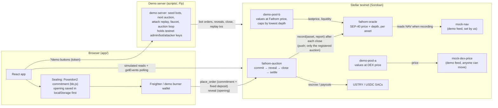

# Fathom

Sealed periodic auctions for real-world-asset tokens on Stellar, published as an oracle:
a **price** and a measured **depth** (how much can really be sold near that price), so lending
pools stop trusting thin DEX prices.

> Testnet demo only. USTRY and USDC here are demo assets issued by our own test issuer,
> not the real Etherfuse USTRY or Circle USDC. The USTRY NAV and the DEX price are demo feeds we set.

**Live demo:** _app URL after deploy_ · **Backup video:** _link after recording_ ·
**Why:** the [February 2026 YieldBlox exploit](#the-real-event-february-2026).

## Architecture



- **Sealing happens in the browser.** Only the commitment and a fixed-size deposit (10K / 50K / 250K)
  go on-chain; the opening (side, price, quantity, salt) is stored locally before sending and revealed
  from the browser in the reveal window.
- **Push, not pull.** After each close the auction pushes one report to the oracle. The oracle stores
  everything per asset; its reads (`lastprice`, `depth`, `liquidity`) never call another contract.
- **Pools read the oracle.** Pool B values collateral at Fathom's price and caps total USTRY collateral
  at 50% of the lowest depth over the oracle's window. Pool A reads the DEX and is the one that gets drained.
- **The demo server** holds the testnet keys for the bots, the admin (demo fast-forward) and the
  attacker, so the browser never does.

## Contract IDs (testnet)

<!-- contract-ids:start -->
| Contract | ID | Role |
|---|---|---|
| fathom-auction | [`CDLLGJQUQ2SNV6267S7TSLS3IU6ASGOQP6MKCLMUEHC4D7DFLVNDFDEI`](https://stellar.expert/explorer/testnet/contract/CDLLGJQUQ2SNV6267S7TSLS3IU6ASGOQP6MKCLMUEHC4D7DFLVNDFDEI) | sealed orders, reveal, clearing, settlement |
| fathom-oracle | [`CDVMYAYRRQC2QJDBGNHUD54SA2DMJJQJR2W5IAFVQGA3SDPZ4I3O6LXY`](https://stellar.expert/explorer/testnet/contract/CDVMYAYRRQC2QJDBGNHUD54SA2DMJJQJR2W5IAFVQGA3SDPZ4I3O6LXY) | SEP-40 price + depth |
| demo-pool-a | [`CA2FYHX4E5MQZB7RJOQR7P6CJZS57GGMP7NTGOA4R4VZPFQHEZQRPYAU`](https://stellar.expert/explorer/testnet/contract/CA2FYHX4E5MQZB7RJOQR7P6CJZS57GGMP7NTGOA4R4VZPFQHEZQRPYAU) | naive lender (DEX price) |
| demo-pool-b | [`CAD4UVA3IBEQIWCGABQS72TXKNE3ICOKU3ESRFFXAEU5PCQKPFGUVVVZ`](https://stellar.expert/explorer/testnet/contract/CAD4UVA3IBEQIWCGABQS72TXKNE3ICOKU3ESRFFXAEU5PCQKPFGUVVVZ) | Fathom lender (price + depth cap) |
| mock-nav | [`CAI3KKLOO5L6J3DGTNK7BASTWD67CNE7YMCOUFDNZOEQ3PW77MWMDOAV`](https://stellar.expert/explorer/testnet/contract/CAI3KKLOO5L6J3DGTNK7BASTWD67CNE7YMCOUFDNZOEQ3PW77MWMDOAV) | USTRY NAV, demo feed set by us |
| mock-dex-price | [`CCKQ7A3LPDOC75PCWMIIVG6YBUUFZSJEGTFOHYTHNFPTBGTBVRFMMHQ4`](https://stellar.expert/explorer/testnet/contract/CCKQ7A3LPDOC75PCWMIIVG6YBUUFZSJEGTFOHYTHNFPTBGTBVRFMMHQ4) | thin DEX last price, demo feed |
| USTRY (SAC) | [`CBMXMNLBQVECQ2G7USMEUIB6QLBEXEJF5M4BK4LGG53PYPJCTY5FPJWV`](https://stellar.expert/explorer/testnet/contract/CBMXMNLBQVECQ2G7USMEUIB6QLBEXEJF5M4BK4LGG53PYPJCTY5FPJWV) | demo token |
| USDC (SAC) | [`CBDCVIPPYUN5JZ5FHLXADKE34OHXXHPPBWUROJ53BGGAZLTQ5KCESXE2`](https://stellar.expert/explorer/testnet/contract/CBDCVIPPYUN5JZ5FHLXADKE34OHXXHPPBWUROJ53BGGAZLTQ5KCESXE2) | demo token |
| order verifier | [`CCFQPYDC7JKJPEIR6PQLT2VF4U2GRYGIK5QCNEUTRUVBGU6L63GRKFTA`](https://stellar.expert/explorer/testnet/contract/CCFQPYDC7JKJPEIR6PQLT2VF4U2GRYGIK5QCNEUTRUVBGU6L63GRKFTA) | rs-soroban-ultrahonk with circuits/order's vk (verifier demo) |
| issuer | [`GDSK6TCBLJJBAK4KG5BHKTSOZTMIONTJAOCTSHZM6U55M7J4S3OQB3SF`](https://stellar.expert/explorer/testnet/account/GDSK6TCBLJJBAK4KG5BHKTSOZTMIONTJAOCTSHZM6U55M7J4S3OQB3SF) | issues the demo tokens |
<!-- contract-ids:end -->

## Run it

```bash
# 1. Contracts (Rust 1.92, stellar-cli 28.1)
cargo test                                  # 36 contract tests
cd scripts && npm install
npm run deploy                              # idempotent; writes deployments/testnet.json and app/.env*

# 2. Demo server (keys from the Stellar CLI keystore, 127.0.0.1 only, no token)
npm run demo-server -- --loop               # --loop: reveal bots, close auctions, seed, continuously

# 3. Circuit (nargo 1.0.0-beta.9, bb 0.87.0): test, prove the example, write the vk
../circuits/build.sh

# 4. App
cd ../app && npm install && npm run dev      # http://localhost:5173  (add ?demo for the demo bar)
```

Other scripts: `npm run worked-example` (the worked example as a real auction), `npm run replay`
(attack replay from the CLI), `npm run seed`, `npm run auction-loop`.

### Hosted demo

- **Demo server on Fly** (`fly.toml`, `Dockerfile`): always on (`auto_stop_machines = "off"`), auction
  loop running, state (bot openings) on a volume. Keys are Fly secrets exported from the local keystore
  (`npx tsx scripts/export-demo-secrets.ts | fly secrets import`), never in the image. Demo actions need
  `Authorization: Bearer $DEMO_TOKEN`; every POST is rate limited per IP (12/min), the faucet per address
  (1 per 10 min). CORS only for `ALLOWED_ORIGINS`.
- **App on Vercel** (`app/vercel.json`): builds with the committed `app/.env.production` (public contract
  ids, `VITE_DEMO_API` pointing at the Fly server). Open with `?demo=<token>` for the demo bar.

## Honest limits

- **Visible on-chain:** each order's **side** (USDC deposit = buy, USTRY = sell) and **deposit size** (one
  of three fixed sizes). Price and quantity are hidden until the close. Confidential token deposits would
  hide size and side; not in this build.
- **Zero-knowledge proof is checked in the browser, not on-chain.** Each order gets a zero-knowledge
  UltraHonk proof (`circuits/order`, Noir 1.0.0-beta.9, bb.js 0.87.0, ~1.2 s in a Web Worker) that it is on
  the price grid and funded; it is verified in the browser before the order is sent, and never posted. The
  only Soroban verifier available ([rs-soroban-ultrahonk](https://github.com/NethermindEth/rs-soroban-ultrahonk))
  accepts *non*-ZK proofs, which can leak the order. So on-chain verification runs only in the **Verifier
  demo** panel (`?verifier` or `?demo`, on How it works) for a fixed dummy order: verified on testnet in
  [f13a8853…](https://stellar.expert/explorer/testnet/tx/f13a88532ec27f35820c29ff52c92bb84d720bb4e7e4387d27250c569701d87a).
  A tampered proof (one bit of the public deposit flipped) is rejected by the same contract; the panel runs
  that check as a **simulation** (the contract's verification code on Soroban, labelled as such), because a
  rejected verification is not recorded on-chain. The contract checks funding again at reveal.
- **Demo feeds.** The USTRY NAV ($1.06) comes from `mock-nav` and the DEX price from `mock-dex-price`, both
  set by us and tagged so in the app.
- **Blend integration goes through the oracle-aggregator.** Blend pools read prices through an
  aggregator such as [blend-capital/oracle-aggregator](https://github.com/blend-capital/oracle-aggregator),
  which needs a SEP-40 source with `last_timestamp`, `price(asset, timestamp)`, `resolution` and `decimals`
  (Fathom has all four). Two caveats: the aggregator only passes on the **price**, not depth (the depth cap
  is Pool B's own logic), and it rejects prices older than its `max_age` (6–60 min), so daily auctions would
  need the price republished each hour or auctions at least hourly. Nothing here is integrated with a real
  Blend pool.
- **Bait-and-switch window is short in the demo:** pools use the lowest depth over 30 minutes (production:
  weeks), so depth added just before a demo does not count yet.
- **Sybil / wash resistance** relies on locked, non-cancellable standing bids; bonded membership and
  nullifiers are not implemented.

## The real event (February 2026)

The YieldBlox DAO pool on Blend V2 was exploited on 22 February 2026 at 00:25 UTC: one trade on a USTRY
market with less than $1 of hourly volume moved the price from about $1.06 to about $106, and the inflated
collateral was borrowed against. **About $10–11M drained, about $7M frozen** by Stellar Tier-1 validators
([Halborn](https://www.halborn.com/blog/post/explained-the-yieldblox-hack-february-2026),
[Protos](https://protos.com/yieldblox-lending-pool-hit-by-10m-hack-on-stellar/),
[Rekt](https://rekt.news/yieldblox-rekt)). The sources' exact counts differ within that range.

## Details

### Deploy script

```bash
cargo test                     # contract unit tests
cd scripts && npm install
npm run deploy                 # creates CLI identities fathom-admin / fathom-issuer, tokens, SACs, contracts
npm run worked-example         # runs the worked example as a real auction on testnet, prints tx links
npm run replay                 # attack replay: pump DEX ×100, drain Pool A, Pool B rejects
npm run seed                   # seal a round of bot orders
npm run auction-loop           # keep auctions running: reveal bots, close, seed
```

`deploy` is idempotent: a contract is redeployed only when its WASM or constructor arguments change
(dependency ids are arguments, so changes cascade). It writes public contract ids to
`deployments/testnet.json` and the app config to `app/.env` (gitignored). Keys stay in the Stellar
CLI keystore, never in the repo. All tunable parameters live in `scripts/config.ts`.

### How an auction runs (`contracts/fathom-auction`)

| Step | Call | What happens |
|---|---|---|
| Seal | `place_order(owner, commitment, deposit_token, deposit_amount, standing)` | Commitment + deposit into escrow. Deposit is one of 10k / 50k / 250k. USDC deposit = buy, USTRY = sell. |
| Reveal | `reveal(owner, order_id, side, price_tick, qty, salt)` | During the reveal window. Contract recomputes the Poseidon2 commitment and checks funding. |
| Close | `close_auction()` | Anyone, after the reveal window. One uniform price maximizing matched volume; fills recorded; standing buys carried; unrevealed orders lose 1%. |
| Settle | `settle(order_ids)` | Anyone. Pays out recorded fills and refunds, in batches. |

**What is hidden:** price and quantity, until the close. **What is visible:** side (from the deposit token)
and deposit size (one of three fixed sizes). Confidential deposits would hide both; not in this MVP.

`commitment = Poseidon2(side, price_tick, qty, salt, owner_field)` over BN254, matching Noir's
`Poseidon2::hash` (a test pins a vector computed with nargo 1.0.0-beta.9).
`owner_field = sha256(owner G… strkey)` with its first byte zeroed.

Close and settle are separate because testnet caps events at 16 KB per transaction and every
token transfer emits one; a busy close would not fit. Measured: close with 24 orders ≈ 4.8M CPU instructions,
settle of 8 orders ≈ 5.9M.

A transaction can fail on-chain when the state changed after it was simulated (a window ended, or another
order landed first). Clients re-simulate and resend FAILED transactions (`scripts/lib/fathom.ts`,
`app/src/lib/tx.ts`). See "Concurrency notes" below.

Demo mode: `fast_forward()` (admin) ends the current commit window, or the reveal window, immediately.

### Oracle (`contracts/fathom-oracle`)

A separate contract so more assets can be added without redeploying. The admin registers each asset
with the one auction contract allowed to report for it: `register_asset(asset, auction, nav_feed)`.
After each close, that auction pushes one `AuctionReport` (`record`). The oracle computes everything
then and stores it per asset; reads never call another contract.

| Read | Returns |
|---|---|
| `lastprice(asset)` (SEP-40) | median of the last 7 clearing prices, capped at NAV. `None` if the last auction had < $10k notional or < 5 orders |
| `price`, `prices`, `base`, `assets`, `decimals`, `resolution` (SEP-40) | published price history, newest first for `prices` |
| `depth(asset)` | open standing-buy quantity priced ≥ NAV − 5% |
| `liquidity(asset)` | price, NAV, haircut, depth, lowest depth over the window, order count, notional, status |

Even-length median (fewer than 7 auctions so far) takes the lower middle value. Assets without a NAV
feed use the median itself, with no haircut.

### Demo pools

- **Pool A** (`demo-pool-a`) values USTRY at the thin DEX price. One trade pumps it ×100 and the pool is drained.
- **Pool B** (`demo-pool-b`) values USTRY at Fathom `lastprice` × LTV and rejects any borrow that would take
  total USTRY collateral above 50% of Fathom's lowest depth over the window (`Error #2, DepthTooLow`).

Both use LTV 75% (each pool's own choice) and share error codes: 1 no price, 2 depth too low,
3 not enough collateral, 4 pool empty, 5 bad amount.

Pool B's `assess` returns every failed check with its numbers (collateral value at the Fathom price,
max loan, depth cap vs requested). `borrow` fails with the first reason. `attempt_borrow` does the
same checks but records a rejection on-chain (a `borrow_rejected` event with every reason, no funds
moved), so the replay has a transaction to link to. It is not called `try_borrow` because Soroban's
generated Rust client already defines `try_borrow` for `borrow`.

### App (`app/`)

Vite + React + TypeScript, ported from `designs/`, reading the testnet contracts.
Screens: Auction (`/`), Last close (`/close`), Liquidity, Attack replay, How it works.

```bash
cd scripts && npm run demo-server -- --loop    # holds the demo keys; --loop keeps auctions running
cd app && npm install && npm run dev           # http://localhost:5173 (proxies /demo to the demo server)
```

- **Wallet:** Freighter on testnet. A wallet on another network blocks ordering and says how to switch.
  With `?demo` there is also a "Demo wallet" (a testnet burner key kept in this browser, labelled as such).
- **Salt safety:** an order's opening (side, price, quantity, salt) is saved to localStorage *before* the
  order is sent; "Download backup" / "Restore" in Your orders. The tab reveals automatically in the reveal
  window; "Reveal now" with a countdown is always shown, with the 1% penalty warning.
- **Live updates:** the app polls contract events (`placed`, `closed`, `recorded`, …): new sealed orders
  slide in, a pink banner announces each close, the dashboard refreshes.
- **States:** every read shows loading, empty, error (with retry) and data; every transaction shows
  pending, success with a stellar.expert link, or the error.
- **`?demo`:** a bottom bar with Seed bot orders, Next auction (ends commits, waits for your reveals,
  closes and settles, up to the auction on screen) and Run attack replay (each step a real transaction).
  The demo server holds the admin, bot and attacker keys (Stellar CLI keystore); the browser never does.
- **`?mock`:** the design numbers, injected only by `npm run compare` (screenshots vs `designs/`); the app
  itself ships no mock data.
- **Every number's source** (contract read, event, config, computed, hard-coded label):
  [docs/number-audit.md](docs/number-audit.md). Values we set ourselves (mock NAV, mock DEX price, attack
  scenario) carry a "set by us" tag.

```bash
npm test               # unit tests: tx retry, commitment matches the contract
npm run compare        # screenshots vs designs at 1440/390 → app/.compare/
node tools/e2e.mjs     # full browser-driven run on testnet; logs every stellar.expert link
```

Differences from the designs: [docs/design-diff.md](docs/design-diff.md). Last full testnet run:
[docs/testnet-run.md](docs/testnet-run.md).

#### Before presenting

Pool B caps borrowing at 50% of the *lowest* depth over the oracle's window (30 min in the demo). Depth
added just before the demo does not count until the window has passed: that is the bait-and-switch
protection. Run `npm run demo-server -- --loop` for at least 30 minutes before presenting so the
dashboard shows a real cap.

#### Concurrency notes

- Order ids are derived from the commitment, not a counter, so concurrent orders touch different keys.
- `place_order` appends to the auction's order list; clients declare 512 extra write bytes so an order
  that lands just after another one does not fail ("byte-write resources exceeds amount specified").
- Transactions that fail on-chain (nothing applied) are re-simulated and resent after a short random wait.

### Conventions

All prices are 7-decimal fixed point (`$1.06 = 10_600_000`), like Stellar token amounts.

### Layout

- `contracts/mock-nav`: admin-set NAV feed for USTRY ($1.06)
- `contracts/mock-dex-price`: thin "last trade" price that anyone can move (used by the attack replay)
- `contracts/fathom-auction`: sealed orders, reveal, clearing, settlement, standing orders
- `contracts/fathom-oracle`: SEP-40 price + depth per asset, fed by auction pushes
- `contracts/demo-pool-a`, `contracts/demo-pool-b`: naive lender vs Fathom lender
- `crates/fathom-common`: types and client interfaces shared by the contracts
- `scripts/config.ts`: every parameter in one place
- `scripts/deploy.ts`: testnet deployment
- `scripts/worked-example.ts`: the worked example (+ Eve's standing bid), end to end on testnet
- `scripts/replay-attack.ts`: the YieldBlox-style replay
- `designs/`: approved screen designs (reference for the React port)

## Toolchain (pinned)

| Tool | Version | Why this version |
|---|---|---|
| Rust | 1.92.0, target `wasm32v1-none` | `rust-toolchain.toml` |
| soroban-sdk | 28.0.0 | required by rs-soroban-ultrahonk and soroban-poseidon |
| stellar-cli | 28.1.0 | |
| Noir (nargo) | 1.0.0-beta.9 | only version the UltraHonk verifier supports |
| Barretenberg (bb) | 0.87.0 | same; Keccak oracle |
| Node | 24 | |

Testnet runs protocol 29 (verifier needs ≥ 28).

Installing bb 0.87.0: `bbup -v 0.87.0` builds a wrong release URL; download it directly instead:
`curl -L https://github.com/AztecProtocol/aztec-packages/releases/download/v0.87.0/barretenberg-amd64-linux.tar.gz | tar -xzC ~/.bb`
