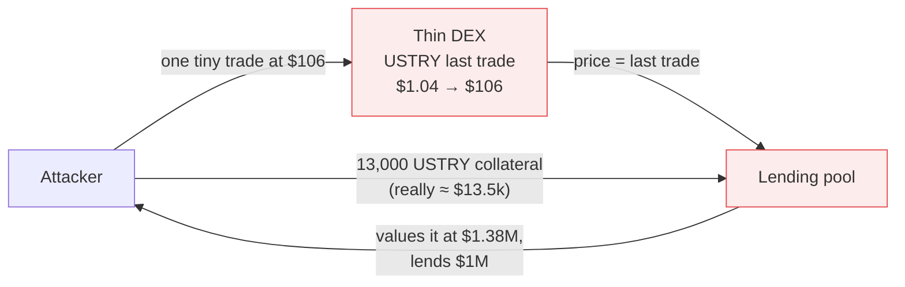
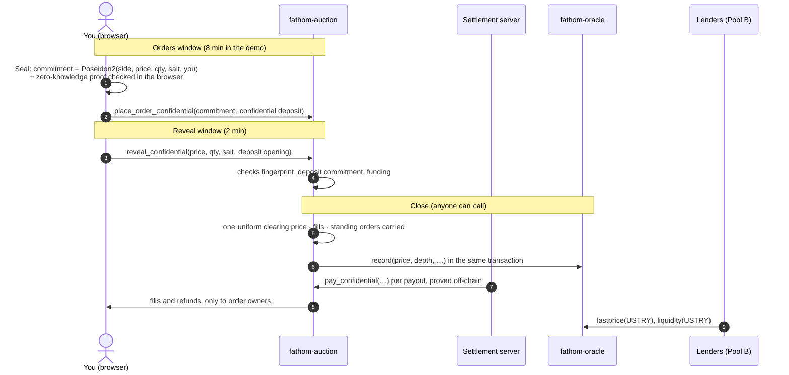
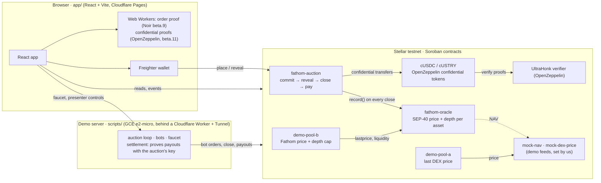

<p align="center">
  
</p>

<p align="center">
  <b>A price you can lend against, and the depth to prove it.</b><br>
  Sealed periodic auctions for real-world-asset tokens on Stellar, published as an oracle.
</p>

<p align="center">
  <a href="https://fathom-b3t.pages.dev"><b>Live demo (Stellar testnet)</b></a> ·
  <a href="#the-problem">Problem</a> ·
  <a href="#how-fathom-works">How it works</a> ·
  <a href="#a-tour-of-the-app">Tour</a> ·
  <a href="#architecture">Architecture</a> ·
  <a href="#run-it">Run it</a>
</p>

> Testnet demo. USTRY and USDC here are demo assets from our own test issuer, not the real Etherfuse
> USTRY or Circle USDC. The USTRY NAV and the thin-DEX price are demo feeds we set, and the app tags them.

---

## The problem

Tokenized real-world assets, like tokenized US Treasury bills, are arriving on Stellar faster than
markets for them. Lending pools want to accept them as collateral, so they need a **price**. The only
on-chain price is usually the **last trade on a thin DEX**, where a few dollars can set any price.



This happened. On **22 February 2026**, one trade on a USTRY market with **less than $1 of hourly
volume** moved the price from about $1.06 to about $106, and a Blend V2 lending pool (YieldBlox DAO) was
borrowed against at that price: **about $10–11M drained**, about $7M later frozen by Stellar validators
([Halborn](https://www.halborn.com/blog/post/explained-the-yieldblox-hack-february-2026),
[Protos](https://protos.com/yieldblox-lending-pool-hit-by-10m-hack-on-stellar/),
[Rekt](https://rekt.news/yieldblox-rekt)).

Two things were missing:

1. **A price that one trade cannot move.**
2. **A measure of depth**: how much of the asset could really be sold near that price. Even a correct
   price is dangerous if a pool accepts more collateral than the market could ever absorb.

## The idea

**Fathom runs a sealed-bid auction for the asset every few minutes, and publishes its result as an
oracle.**

- Orders are **sealed**: price and quantity stay hidden until the close, so nobody can trade against
  them or front-run them. By default the deposit amount is hidden too (confidential tokens).
- Everyone fills at **one uniform price**, the one where the most can trade.
- The oracle publishes a **price**: the median of the last 7 clearing prices, capped at NAV, and only
  when an auction had real participation (≥ $10k traded, ≥ 5 orders).
- It also publishes **depth**: standing buy orders, locked for 7 days, within 5% of NAV. Selling into
  your own order fills it and removes it, so **depth can only be faked downwards**.
- Lenders read both through a standard **SEP-40** feed. Our demo Pool B values collateral at Fathom's
  price and caps how much USTRY it accepts at 50% of the lowest depth over a window.

<p align="center"></p>

## How Fathom works



| Step | What happens | Where |
|---|---|---|
| 1. Seal | Your browser commits to the order with a fingerprint (Poseidon2 + random salt) and checks a zero-knowledge proof that it is on the price grid and funded. Only the fingerprint goes on-chain. | `app/src/stellar/commitment.ts`, `circuits/order` |
| 2. Deposit | USDC (buy) or USTRY (sell) is wrapped into an OpenZeppelin confidential token and sent to the auction as a confidential transfer of exactly what the order needs. | `app/src/stellar/confidential.ts` |
| 3. Reveal | In the reveal window your tab discloses the order and the deposit's opening; the contract checks both. Unrevealed orders pay a 1% penalty. | `contracts/fathom-auction/src/confidential.rs` |
| 4. Close | One price where the most USTRY trades, on a $0.01 grid; everyone fills at it. Standing buy orders stay for 7 days. | `contracts/fathom-auction/src/clearing.rs` |
| 5. Payouts | The settlement server proves each payout; the contract checks every amount and pays only the order's owner. | `scripts/lib/demo.ts` (`settleConfidential`) |
| 6. Publish | The close pushes price and depth to the oracle, read through SEP-40. | `contracts/fathom-oracle` |

### What is hidden, and until when

| | While orders come in | After your reveal | After the close |
|---|---|---|---|
| Price and quantity | **hidden** | public | public |
| Deposit amount | **hidden** | public | public |
| Side (buy / sell) | public | public | public |
| Your address | public | public | public |

"Hidden" means hidden from everyone on-chain. Two honest caveats: the demo **settlement server can see
deposit amounts** (it holds the auction's key to prove payouts), and confidential-token proofs are
**not zero-knowledge yet** (Soroban's only UltraHonk verifier is the non-ZK flavour). Details in
[Honest limits](#honest-limits).

## A tour of the app

**[fathom-b3t.pages.dev](https://fathom-b3t.pages.dev)** runs on Stellar testnet. Auctions run every
~10 minutes with bots. To trade, use Freighter on testnet: the funding panel gives you test XLM, trustlines
and demo tokens.

| | |
|---|---|
|  | **Trade**: a swap-style widget to place a sealed buy or sell order. The background animates the idea: a sonar, sealed envelopes and bid paddles rising, privacy coins, a candlestick chart forming, a gavel that strikes "Cleared" and a candle-auction candle. |
|  | **Sealing your order**: each step animated (keys, wrap, prove, lock) with its status; the first order also registers you for the confidential tokens with one wallet signature. |
|  | **Auction**: the live auction taking orders, its countdown, the sealed orders (no prices shown), the last clearing price and the market depth. |
|  | **Results**: the last auction opened: supply meets demand at one price, every revealed order, and what was published to the oracle. |
|  | **Price & depth**: what Fathom publishes for lenders: price, depth, how much more Pool B can take, the history, and the SEP-40 calls. |
|  | **Attack demo**: the February attack in six steps, Pool A (DEX price) drained vs Pool B (Fathom) rejecting the same loan. With the presenter token it runs as real testnet transactions. |
|  | **How it works**: a guided walkthrough of the six steps, what is hidden when, and what you are trusting in this demo. |

## Architecture



- **Push, not pull.** Each close pushes one report to the oracle; oracle reads never call another
  contract, so lenders get cheap, predictable reads.
- **Keys never in the browser.** Bots, admin, attacker and the auction's confidential key live on the
  demo server (Secret Manager on the VM). The browser only ever signs with your wallet.
- **Hosting at $0/month:** a free-tier Google Compute Engine VM with no public IPv4, reached only through
  a Cloudflare Tunnel and a Worker on `workers.dev`; the app on Cloudflare Pages. All Terraform, see
  [infra/README.md](infra/README.md).

## Repository structure

```text
fathom/
├── contracts/                    Soroban smart contracts (Rust, soroban-sdk 28)
│   ├── fathom-auction/           sealed orders, reveal, uniform-price clearing, payouts
│   │   └── src/confidential.rs   confidential deposits: commitment checks, proved payouts
│   ├── fathom-oracle/            SEP-40 price + depth per asset, fed by auction pushes
│   ├── demo-pool-a/              naive lender: values collateral at the DEX price
│   ├── demo-pool-b/              Fathom lender: Fathom price + depth cap, records rejections
│   ├── mock-nav/                 demo NAV feed (set by us)
│   └── mock-dex-price/           demo thin-DEX last price (anyone can move it)
├── crates/fathom-common/         types and client interfaces shared by the contracts
├── circuits/order/               Noir circuit: the order is on the price grid and funded
├── app/                          React + Vite frontend
│   ├── src/screens/              Trade, Auction, Results, Price & depth, Attack demo, How it works
│   ├── src/stellar/              wallet, commitments, confidential tokens, contract client
│   ├── src/zk/                   proving in Web Workers (order proof, confidential proofs)
│   └── tools/                    browser end-to-end test, screenshots, benchmarks
├── scripts/                      deploy, demo server (bots, auction loop, settlement), CLI demos
│   ├── config.ts                 every parameter in one place
│   └── lib/confidential.ts       confidential tokens on the server side
├── vendor/openzeppelin-confidential/   OpenZeppelin confidential token contracts (wasm, provenance)
├── deployments/                  contract ids per network (public)
├── infra/                        Terraform: GCE VM, Cloudflare Pages/Tunnel/Worker, Workload Identity
├── docker/, docker-compose.yml   containers for the app and the demo server
├── designs/                      the original screen designs
└── docs/                         testnet run logs, design diff, number audit, screenshots
```

## Run it

```bash
# 1. Contracts (Rust 1.92, stellar-cli 28.1)
cargo test                                  # 41 contract tests
cd scripts && npm install
npm run deploy                              # idempotent; confidential stack by default

# 2. Demo server (keys from the Stellar CLI keystore, 127.0.0.1 only, no token)
npm run demo-server -- --loop               # --loop: bots, reveals, closes, payouts, continuously

# 3. Circuit (nargo 1.0.0-beta.9, bb 0.87.0): test, prove the example, write the vk
../circuits/build.sh

# 4. App
cd ../app && npm install && npm run dev      # http://localhost:5173 (confidential stack)
```

`CONFIDENTIAL_DEPOSITS=false` (scripts) and `npm run dev:fixed` (app) run the fixed-size-deposit stack
instead. To use the hosted demo server from a local app:
`DEMO_PROXY_TARGET=https://fathom-demo-api.<subdomain>.workers.dev npm run dev`.

Tests:

```bash
cargo test                       # contracts
cd app && npm test               # unit tests (commitment parity, tx retry)
node tools/e2e.mjs               # full browser-driven run on testnet; logs every stellar.expert link
```

### Docker Compose (full demo on localhost)

```bash
[ -f .env.local ] || cp .env.example .env.local               # gitignored
# Testnet demo keys from your Stellar CLI keystore. Load .env.local first: it holds the auction's
# confidential key (FATHOM_CONF_AUCTION_SK), which the export copies; overwriting without it loses it.
set -a; . ./.env.local; set +a
(cd scripts && npx tsx export-demo-secrets.ts) > .env.local.new && mv .env.local.new .env.local
docker compose up -d --build                                 # http://localhost:8080  (add ?demo)
```

| Service | What | Profile |
|---|---|---|
| `app` | the Vite build on unprivileged nginx (port 8080), proxying `/demo` to the demo server | default |
| `demo-server` | demo controls + auction loop (testnet), keys from `.env.local`, state on a volume | default |
| `app-dev` | Vite with hot reload on http://localhost:5173 | `dev` |
| `stellar` | `stellar/quickstart` local network (protocol 29, unlimited limits) on :8000 | `local` |
| `demo-server-local` | demo server pointed at the local network, on :8788 | `local` |

All images run as non-root, read-only, with health checks and `restart: unless-stopped`; ports are
published on 127.0.0.1 only, so the local demo server needs no token. The default network is testnet.

Local network instead of testnet:

```bash
docker compose --profile local up -d stellar                     # wait for it to be healthy
(cd scripts && FATHOM_NETWORK=local npm run deploy)               # contracts + deployments/local.json + app/.env
DEMO_PROXY_TARGET=http://demo-server-local:8787 docker compose --profile local --profile dev up -d
# app with hot reload on :5173 (reads app/.env); run `npm run deploy` again to switch app/.env back to testnet
```

### Hosted demo

Google Compute Engine free-tier VM (demo server) + Cloudflare Pages (app) + a Worker on `workers.dev`
that reaches the VM through Cloudflare Tunnel with Workers VPC. No domain, no inbound access to the VM,
$0/month, all in Terraform (HCP Terraform with GCP Workload Identity Federation):
[infra/README.md](infra/README.md).

The presenter controls (seed bots, next auction, run the attack live) appear only with
`?demo=<token>`; visitors never see them.

## Reference

### Contract IDs (testnet)

The default stack (`deployments/testnet-confidential.json`). The fixed-size stack's IDs are in
`deployments/testnet.json`.

<!-- contract-ids:start -->
| Contract | ID | Role |
|---|---|---|
| fathom-auction | [`CD66PTNIW7PY32N4OUKRFQJXHVDW5FBD2UZQG6AFHUTQVOU24QXE5GEM`](https://stellar.expert/explorer/testnet/contract/CD66PTNIW7PY32N4OUKRFQJXHVDW5FBD2UZQG6AFHUTQVOU24QXE5GEM) | sealed orders, reveal, clearing, settlement |
| fathom-oracle | [`CCHVIQYCZZXVHSEXRLHV53GIGACOLENCFNHJNBICS4JYJMZBDEYKS5PS`](https://stellar.expert/explorer/testnet/contract/CCHVIQYCZZXVHSEXRLHV53GIGACOLENCFNHJNBICS4JYJMZBDEYKS5PS) | SEP-40 price + depth |
| demo-pool-a | [`CB2XYQYVE5ZQEJSKFXNB47HKHNKW5WP2PCPMYRGVSZ2PKMBW5HCGGQ5P`](https://stellar.expert/explorer/testnet/contract/CB2XYQYVE5ZQEJSKFXNB47HKHNKW5WP2PCPMYRGVSZ2PKMBW5HCGGQ5P) | naive lender (DEX price) |
| demo-pool-b | [`CCUGEO27VXVN3EEISUZ2HNGOA4BNAM427ABIEMAPIWBJXGA3KDY7PG4B`](https://stellar.expert/explorer/testnet/contract/CCUGEO27VXVN3EEISUZ2HNGOA4BNAM427ABIEMAPIWBJXGA3KDY7PG4B) | Fathom lender (price + depth cap) |
| mock-nav | [`CDLLSBQXPVPRT4DM3MVOLAPQRJ72T44YWM2HSHVSEWKCDJGD37NU2E5T`](https://stellar.expert/explorer/testnet/contract/CDLLSBQXPVPRT4DM3MVOLAPQRJ72T44YWM2HSHVSEWKCDJGD37NU2E5T) | USTRY NAV, demo feed set by us |
| mock-dex-price | [`CDJNBL45S4OZABEBIH7ERSMXCSNE5QDIBGE35KIEIKOCHUBOVGQOFPQG`](https://stellar.expert/explorer/testnet/contract/CDJNBL45S4OZABEBIH7ERSMXCSNE5QDIBGE35KIEIKOCHUBOVGQOFPQG) | thin DEX last price, demo feed |
| USTRY (SAC) | [`CBMXMNLBQVECQ2G7USMEUIB6QLBEXEJF5M4BK4LGG53PYPJCTY5FPJWV`](https://stellar.expert/explorer/testnet/contract/CBMXMNLBQVECQ2G7USMEUIB6QLBEXEJF5M4BK4LGG53PYPJCTY5FPJWV) | demo token |
| USDC (SAC) | [`CBDCVIPPYUN5JZ5FHLXADKE34OHXXHPPBWUROJ53BGGAZLTQ5KCESXE2`](https://stellar.expert/explorer/testnet/contract/CBDCVIPPYUN5JZ5FHLXADKE34OHXXHPPBWUROJ53BGGAZLTQ5KCESXE2) | demo token |
| order verifier | [`CCFQPYDC7JKJPEIR6PQLT2VF4U2GRYGIK5QCNEUTRUVBGU6L63GRKFTA`](https://stellar.expert/explorer/testnet/contract/CCFQPYDC7JKJPEIR6PQLT2VF4U2GRYGIK5QCNEUTRUVBGU6L63GRKFTA) | rs-soroban-ultrahonk with circuits/order's vk (verifier demo) |
| issuer | [`GDSK6TCBLJJBAK4KG5BHKTSOZTMIONTJAOCTSHZM6U55M7J4S3OQB3SF`](https://stellar.expert/explorer/testnet/account/GDSK6TCBLJJBAK4KG5BHKTSOZTMIONTJAOCTSHZM6U55M7J4S3OQB3SF) | issues the demo tokens |
| cUSDC (confidential) | [`CCRMWYI4NHQMPYGVTL5MSBS5SJUZYPYEX52KJ4RXLT6S7LNY5Y7R24F6`](https://stellar.expert/explorer/testnet/contract/CCRMWYI4NHQMPYGVTL5MSBS5SJUZYPYEX52KJ4RXLT6S7LNY5Y7R24F6) | OpenZeppelin confidential token wrapping USDC |
| cUSTRY (confidential) | [`CDASZDGFIAKR3Q443BLI67IMG7OZKQYFABZBEO5ZO3BC4RQ5OYHD4ZTE`](https://stellar.expert/explorer/testnet/contract/CDASZDGFIAKR3Q443BLI67IMG7OZKQYFABZBEO5ZO3BC4RQ5OYHD4ZTE) | OpenZeppelin confidential token wrapping USTRY |
| confidential verifier | [`CBP2U65323GODHUBALNCZSQZZJBYEM6EB37GQGY5JPVKWEAOADQLJOYN`](https://stellar.expert/explorer/testnet/contract/CBP2U65323GODHUBALNCZSQZZJBYEM6EB37GQGY5JPVKWEAOADQLJOYN) | OpenZeppelin UltraHonk verifier (non-ZK), 6 circuit VKs |
| confidential auditor | [`CDALVDWVEQI56NRDAFO2GU5YD77KFNNWNFEMLWSAZYVPWBBNIMLZU7AM`](https://stellar.expert/explorer/testnet/contract/CDALVDWVEQI56NRDAFO2GU5YD77KFNNWNFEMLWSAZYVPWBBNIMLZU7AM) | OpenZeppelin auditor key registry |
<!-- contract-ids:end -->

### Auction contract (`contracts/fathom-auction`)

| Step | Call | What happens |
|---|---|---|
| Seal | `place_order(owner, commitment, deposit_token, deposit_amount, standing)` | Commitment + deposit into escrow. Deposit is one of 10k / 50k / 250k. USDC deposit = buy, USTRY = sell. |
| Reveal | `reveal(owner, order_id, side, price_tick, qty, salt)` | During the reveal window. Contract recomputes the Poseidon2 commitment and checks funding. |
| Close | `close_auction()` | Anyone, after the reveal window. One uniform price maximizing matched volume; fills recorded; standing buys carried; unrevealed orders lose 1%. |
| Settle | `settle(order_ids)` | Anyone. Pays out recorded fills and refunds, in batches. |
| Seal (confidential) | `place_order_confidential(owner, commitment, side, standing, data)` | `data` is a confidential transfer owner → auction (proved in the browser); its commitment `c_transfer` is stored with the order. Any amount. |
| Reveal (confidential) | `reveal_confidential(…, amount, blinding)` | Checks `amount·G + blinding·H == c_transfer` (Grumpkin, `stellar-contract-utils`), then the usual checks including funding. |
| Unrevealed (confidential) | `open_deposit(order_id, amount, blinding)` | After the close: releases an unrevealed deposit minus 1%, given its opening. |
| Pay (confidential) | `pay_confidential(order_id, base, amount, blinding, data)` | Settlement server's proved transfer auction → owner; its opening must equal the recorded amount. Always to the order's owner. |

**What is hidden:** price and quantity, until the close; by default also the deposit amount (until the
reveal). **What is visible:** side (from the deposit token). With `CONFIDENTIAL_DEPOSITS=false`, the
deposit size (one of three fixed sizes) is visible too.

`commitment = Poseidon2(side, price_tick, qty, salt, owner_field)` over BN254, matching Noir's
`Poseidon2::hash` (a test pins a vector computed with nargo 1.0.0-beta.9).
`owner_field = sha256(owner G… strkey)` with its first byte zeroed.

Close and settle are separate because testnet caps events at 16 KB per transaction and every
token transfer emits one; a busy close would not fit. Measured: close with 24 orders ≈ 4.8M CPU instructions,
settle of 8 orders ≈ 5.9M.

A transaction can fail on-chain when the state changed after it was simulated (a window ended, or another
order landed first). Clients re-simulate and resend FAILED transactions (`scripts/lib/fathom.ts`,
`app/src/lib/tx.ts`). See "Concurrency notes" below.

Presenter mode: `fast_forward()` (admin) ends the current commit window, or the reveal window, immediately.

### Oracle contract (`contracts/fathom-oracle`)

A separate contract so more assets can be added without redeploying. The admin registers each asset
with the one auction contract allowed to report for it: `register_asset(asset, auction, nav_feed)`.
After each close, that auction pushes one `AuctionReport` (`record`). The oracle computes everything
then and stores it per asset; reads never call another contract.

| Read | Returns |
|---|---|
| `lastprice(asset)` (SEP-40) | median of the last 7 clearing prices, capped at NAV. `None` if the last auction had < $10k notional or < 5 orders |
| `price`, `prices`, `base`, `assets`, `decimals`, `resolution` (SEP-40) | published price history, newest first for `prices` |
| `depth(asset)` | open standing-buy quantity priced ≥ NAV − 5% |
| `liquidity(asset)` | price, NAV, haircut, depth, lowest depth over the window, order count, notional, status |

Even-length median (fewer than 7 auctions so far) takes the lower middle value. Assets without a NAV
feed use the median itself, with no haircut.

### Demo pools

- **Pool A** (`demo-pool-a`) values USTRY at the thin DEX price. One trade pumps it ×100 and the pool is drained.
- **Pool B** (`demo-pool-b`) values USTRY at Fathom `lastprice` × LTV and rejects any borrow that would take
  total USTRY collateral above 50% of Fathom's lowest depth over the window (`Error #2, DepthTooLow`).

Both use LTV 75% (each pool's own choice) and share error codes: 1 no price, 2 depth too low,
3 not enough collateral, 4 pool empty, 5 bad amount.

Pool B's `assess` returns every failed check with its numbers (collateral value at the Fathom price,
max loan, depth cap vs requested). `borrow` fails with the first reason. `attempt_borrow` does the
same checks but records a rejection on-chain (a `borrow_rejected` event with every reason, no funds
moved), so the replay has a transaction to link to. It is not called `try_borrow` because Soroban's
generated Rust client already defines `try_borrow` for `borrow`.

### Confidential deposits

`CONFIDENTIAL_DEPOSITS` (scripts, demo server, Terraform `confidential_deposits`) and
`VITE_CONFIDENTIAL_DEPOSITS` (app, `vite --mode confidential`) are on by default. `false` runs the
fixed-size escrow stack (`deployments/testnet.json`); `git checkout demo-stable` restores the build from
before this feature.

- **Tokens:** OpenZeppelin `stellar-confidential` 0.8.0 tokens wrapping the demo USDC and USTRY, with
  OpenZeppelin's UltraHonk verifier and an auditor contract. Own deployment:
  `deployments/testnet-confidential.json` (its own auction, oracle and pools).
- **In the browser:** one SEP-53 message signature per token (Freighter `signMessage`) derives the
  confidential keys (kept in memory); one-time `register` on both tokens; wrap and merge when short; then a
  confidential transfer to the auction, proved in a Web Worker (~1.5–2.5 s on a laptop), inside
  `place_order_confidential`.
- **Settlement server:** holds the auction's spending key (`FATHOM_CONF_AUCTION_SK`: Secret Manager on the
  VM, `.env.local` locally). After each close it merges the auction's received deposits and pays each
  recorded amount with one proved transfer, one at a time; unpaid auctions are kept in its state and
  resumed after a restart.
- **Timing:** auctions run 8 minutes (+2 to reveal), because each payout needs a proof. Measured: ~1.5 s
  per proof on a laptop. On the e2-micro, 3.5 s per proof in the hosted loop (auction #6: 8 payouts proved
  and paid in ~90 s); a back-to-back benchmark hit CPU throttling at ~22 s per proof, which 8 minutes still
  absorbs.

Testnet run with the flag on (browser, burner wallet): confidential seal
[7229e7c6…](https://stellar.expert/explorer/testnet/tx/7229e7c61cde53f5ebb4dda9e455355d50d74ab0ff2310f8bed7d051fb412866),
auto-reveal with the opening checked on-chain
[1e33ddbd…](https://stellar.expert/explorer/testnet/tx/1e33ddbd2921a6df4a24f393faa7e3008824dada7015c0e92f8eaa2d795eebd8),
close [0f66f863…](https://stellar.expert/explorer/testnet/tx/0f66f863db6ad001102688550d496705b99080d2806b72d718c4032523b32b30),
a proved payout [3a4f03b3…](https://stellar.expert/explorer/testnet/tx/3a4f03b3ee086ac64aedef454c633fccfe156272f23b5c919f242965533768f9),
attack replay [21b0b87d…](https://stellar.expert/explorer/testnet/tx/21b0b87d60e24dcda27767a6bf0e4e4d8c8e10810b090109241c5c1c74120444).
More in [docs/testnet-run.md](docs/testnet-run.md).

### Honest limits

- **Visible on-chain:** each order's **side** (cUSDC deposit = buy, cUSTRY = sell). Price, quantity and
  (by default) the deposit amount are hidden until the reveal; amounts become public at the reveal and
  close. Wrapping public tokens into the confidential token is public (its amount shows), so wrap a round
  float ahead of time, not each order.
- **The demo settlement server can see amounts.** The auction cannot make proofs (that needs its spending
  key, and a contract cannot keep a secret), so the server holds the auction's key: it decrypts deposits
  sent to the auction as they arrive and proves every payout. It cannot send funds anywhere but to the
  order's owner, for the amount the close recorded: the contract checks each payout's opening. If it stops,
  payouts wait and resume.
- **Confidential-token proofs are not zero-knowledge yet.** They are UltraHonk proofs in the non-ZK flavour,
  verified on-chain by OpenZeppelin's verifier (on rs-soroban-ultrahonk); OpenZeppelin: "a proof is a
  deterministic function of the witness and carries no such guarantee". Amounts sit in Pedersen
  commitments; full amount privacy needs Soroban's zero-knowledge verifier.
- **Zero-knowledge proof is checked in the browser, not on-chain.** Each order gets a zero-knowledge
  UltraHonk proof (`circuits/order`, Noir 1.0.0-beta.9, bb.js 0.87.0, ~1.2 s in a Web Worker) that it is on
  the price grid and funded; it is verified in the browser before the order is sent, and never posted. The
  only Soroban verifier available ([rs-soroban-ultrahonk](https://github.com/NethermindEth/rs-soroban-ultrahonk))
  accepts *non*-ZK proofs, which can leak the order. So on-chain verification runs only in the **Verifier
  demo** panel (`?verifier` or `?demo`, on How it works) for a fixed dummy order: verified on testnet in
  [f13a8853…](https://stellar.expert/explorer/testnet/tx/f13a88532ec27f35820c29ff52c92bb84d720bb4e7e4387d27250c569701d87a).
  A tampered proof (one bit of the public deposit flipped) is rejected by the same contract; the panel runs
  that check as a **simulation** (the contract's verification code on Soroban, labelled as such), because a
  rejected verification is not recorded on-chain. The contract checks funding again at reveal.
- **Demo feeds.** The USTRY NAV ($1.06) comes from `mock-nav` and the DEX price from `mock-dex-price`, both
  set by us and tagged so in the app.
- **Blend integration goes through the oracle-aggregator.** Blend pools read prices through an
  aggregator such as [blend-capital/oracle-aggregator](https://github.com/blend-capital/oracle-aggregator),
  which needs a SEP-40 source with `last_timestamp`, `price(asset, timestamp)`, `resolution` and `decimals`
  (Fathom has all four). Two caveats: the aggregator only passes on the **price**, not depth (the depth cap
  is Pool B's own logic), and it rejects prices older than its `max_age` (6–60 min), so daily auctions would
  need the price republished each hour or auctions at least hourly. Nothing here is integrated with a real
  Blend pool.
- **Bait-and-switch window is short in the demo:** pools use the lowest depth over 30 minutes (production:
  weeks), so depth added just before a demo does not count yet.
- **Sybil / wash resistance** relies on locked, non-cancellable standing bids; bonded membership and
  nullifiers are not implemented.

### Concurrency notes

- Order ids are derived from the commitment, not a counter, so concurrent orders touch different keys.
- `place_order` appends to the auction's order list; clients declare 512 extra write bytes so an order
  that lands just after another one does not fail ("byte-write resources exceeds amount specified").
- Transactions that fail on-chain (nothing applied) are re-simulated and resent after a short random wait.

### Conventions

All prices are 7-decimal fixed point (`$1.06 = 10_600_000`), like Stellar token amounts. Every number
shown in the app has a documented source: [docs/number-audit.md](docs/number-audit.md); values we set
ourselves carry a "set by us" tag. Testnet run logs: [docs/testnet-run.md](docs/testnet-run.md).

### Toolchain (pinned)

| Tool | Version | Why this version |
|---|---|---|
| Rust | 1.92.0, target `wasm32v1-none` | `rust-toolchain.toml` |
| soroban-sdk | 28.0.0 | required by rs-soroban-ultrahonk and soroban-poseidon |
| stellar-cli | 28.1.0 | |
| Noir (nargo) | 1.0.0-beta.9 | our order circuit; the version the UltraHonk verifier supports |
| Barretenberg (bb) | 0.87.0 | same; Keccak oracle |
| OpenZeppelin confidential circuits | nargo 1.0.0-beta.11, bb 0.87.0 | via stellar-confidential-token-sdk `aad1706`, in their own Web Worker |
| OpenZeppelin confidential contracts | stellar-confidential 0.8.0 | vendored wasm, [vendor/openzeppelin-confidential](vendor/openzeppelin-confidential/README.md) |
| Node | 24 | |

Testnet runs protocol 29 (the verifier needs ≥ 28). Installing bb 0.87.0: `bbup -v 0.87.0` builds a wrong
release URL; download it directly:
`curl -L https://github.com/AztecProtocol/aztec-packages/releases/download/v0.87.0/barretenberg-amd64-linux.tar.gz | tar -xzC ~/.bb`
