<p align="center">
  
</p>

<p align="center">
  <b>A price you can lend against, and the depth to prove it.</b><br>
  Sealed periodic auctions for real-world-asset tokens on Stellar, published as an oracle.
</p>

<p align="center">
  <a href="https://fathom-b3t.pages.dev"><b>Live demo (Stellar testnet)</b></a> ·
  <a href="#the-problem">Problem</a> ·
  <a href="#how-fathom-works">How it works</a> ·
  <a href="#a-tour-of-the-app">Tour</a> ·
  <a href="#architecture">Architecture</a> ·
  <a href="#run-it">Run it</a>
</p>

> Testnet demo. USTRY and USDC here are demo assets from our own test issuer, not the real Etherfuse
> USTRY or Circle USDC. The USTRY NAV and the thin-DEX price are demo feeds we set, and the app tags them.

<p align="center">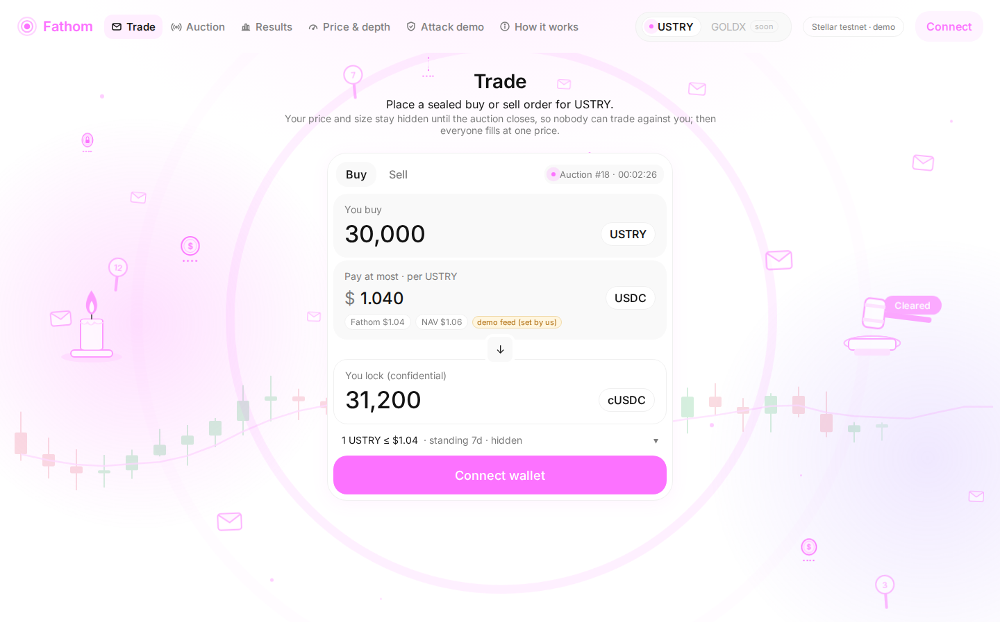</p>

## Contents

1. [The problem](#the-problem): thin-DEX prices and the February 2026 exploit, replayed in six steps
2. [The idea](#the-idea): sealed auctions → a price and a measured depth
3. [How Fathom works](#how-fathom-works): one auction, step by step · [what is hidden](#what-is-hidden-and-until-when)
4. [A tour of the app](#a-tour-of-the-app): every page, with screenshots
5. [Architecture](#architecture): components, contracts and who calls what
6. [Repository structure](#repository-structure)
7. [Run it locally](#run-it-locally): the app in two commands, your own stack, tests
8. [Reference](#reference): [contract IDs](#contract-ids-testnet) · [contracts and methods](#contracts) ·
   [confidential deposits](#confidential-deposits) · [honest limits](#honest-limits) ·
   [toolchain](#toolchain-pinned) · [glossary](#glossary)

---

## The problem

Tokenized real-world assets, like tokenized US Treasury bills, are arriving on Stellar faster than
markets for them. Lending pools want to accept them as collateral, so they need a **price**. The only
on-chain price is usually the **last trade on a thin DEX**, where a few dollars can set any price.

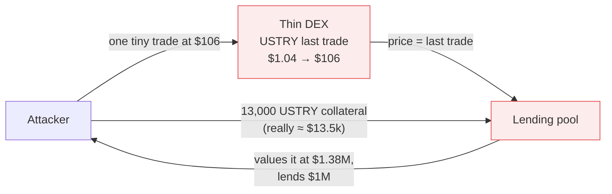

This happened. On **22 February 2026**, one trade on a USTRY market with **less than $1 of hourly
volume** moved the price from about $1.06 to about $106, and a Blend V2 lending pool (YieldBlox DAO) was
borrowed against at that price: **about $10–11M drained**, about $7M later frozen by Stellar validators
([Halborn](https://www.halborn.com/blog/post/explained-the-yieldblox-hack-february-2026),
[Protos](https://protos.com/yieldblox-lending-pool-hit-by-10m-hack-on-stellar/),
[Rekt](https://rekt.news/yieldblox-rekt)).

**The attack, replayed on testnet** in Fathom's [Attack demo](https://fathom-b3t.pages.dev/replay): the same
13,000 USTRY and the same $1M request go to two pools that differ only in their price source.

<p align="center">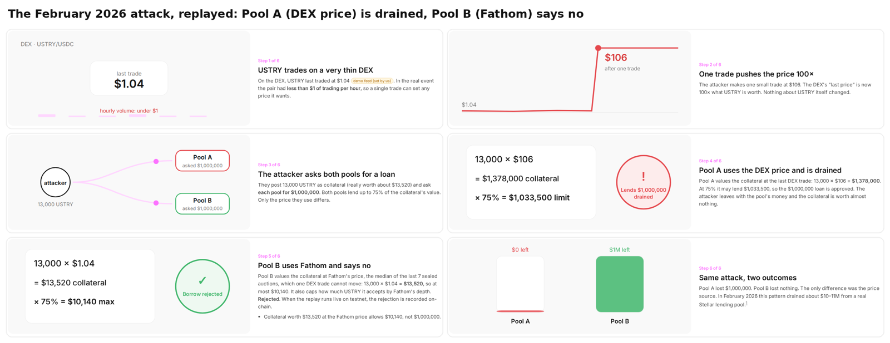</p>

Two things were missing:

1. **A price that one trade cannot move.**
2. **A measure of depth**: how much of the asset could really be sold near that price. Even a correct
   price is dangerous if a pool accepts more collateral than the market could ever absorb.

## The idea

**Fathom runs a sealed-bid auction for the asset every few minutes, and publishes its result as an
oracle.**

- Orders are **sealed**: price and quantity stay hidden while orders are being placed (until each
  order's reveal, after the order window has closed), so nobody can trade against
  them or front-run them. By default the deposit amount is hidden too (confidential tokens).
- Everyone fills at **one uniform price**, the one where the most can trade.
- The oracle publishes a **price**: the median of the last 7 clearing prices, capped at NAV, and only
  when an auction had real participation (≥ $10k traded, ≥ 5 orders).
- It also publishes **depth**: standing buy orders, locked for 7 days, within 5% of NAV. Selling into
  your own order fills it and removes it, so **depth can only be faked downwards**.
- Lenders read both through a standard **SEP-40** feed. Our demo Pool B values collateral at Fathom's
  price and caps how much USTRY it accepts at 50% of the lowest depth over a window.

<p align="center">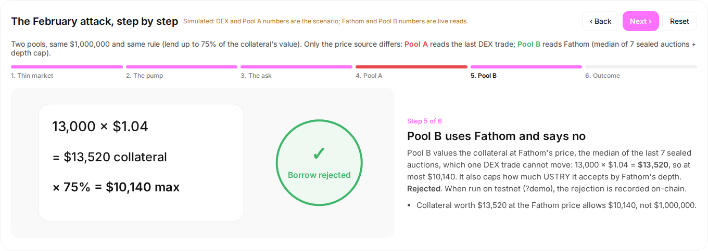</p>

## How Fathom works

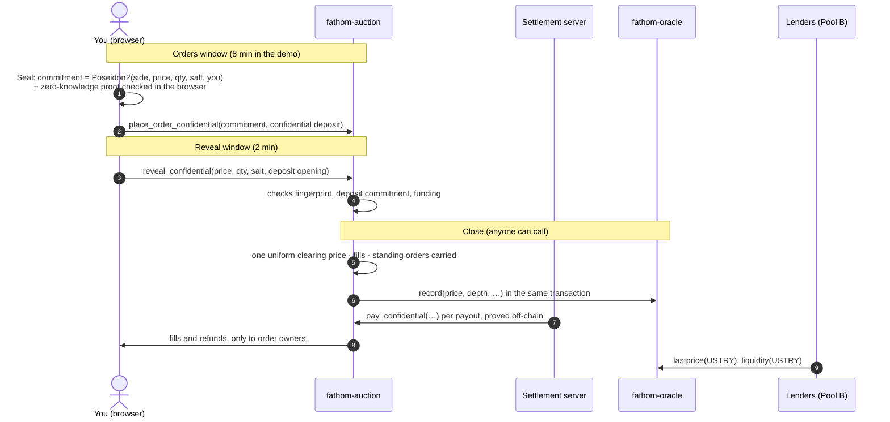

| Step | What happens | Where |
|---|---|---|
| 1. Seal | Your browser commits to the order with a fingerprint (Poseidon2 + random salt) and checks a zero-knowledge proof that it is on the price grid and funded. Only the fingerprint goes on-chain. | `app/src/stellar/commitment.ts`, `circuits/order` |
| 2. Deposit | USDC (buy) or USTRY (sell) is wrapped into an OpenZeppelin confidential token and sent to the auction as a confidential transfer of exactly what the order needs. | `app/src/stellar/confidential.ts` |
| 3. Reveal | In the reveal window your tab discloses the order and the deposit's opening; the contract checks both. Unrevealed orders pay a 1% penalty. | `contracts/fathom-auction/src/confidential.rs` |
| 4. Close | One price where the most USTRY trades, on a $0.01 grid; everyone fills at it. Standing buy orders stay for 7 days. | `contracts/fathom-auction/src/clearing.rs` |
| 5. Payouts | The settlement server proves each payout; the contract checks every amount and pays only the order's owner. | `scripts/lib/demo.ts` (`settleConfidential`) |
| 6. Publish | The close pushes price and depth to the oracle, read through SEP-40. | `contracts/fathom-oracle` |

### What is hidden, and until when

| | While orders come in | After your reveal | After the close |
|---|---|---|---|
| Price and quantity | **hidden** | public | public |
| Deposit amount | **hidden** | public | public |
| Side (buy / sell) | public | public | public |
| Your address | public | public | public |

"Hidden" means hidden from everyone on-chain. Two honest caveats: the demo **settlement server can see
deposit amounts** (it holds the auction's key to prove payouts), and confidential-token proofs are
**not zero-knowledge yet** (Soroban's only UltraHonk verifier is the non-ZK flavour). Details in
[Honest limits](#honest-limits).

## A tour of the app

**[fathom-b3t.pages.dev](https://fathom-b3t.pages.dev)** runs on Stellar testnet. Auctions run every
~10 minutes with bots. To trade, use Freighter on testnet: the funding panel gives you test XLM, trustlines
and demo tokens.

| | |
|---|---|
|  | **Trade**: a swap-style widget to place a sealed buy or sell order. The background animates the idea: a sonar, sealed envelopes and bid paddles rising, privacy coins, a candlestick chart forming, a gavel that strikes "Cleared" and a candle-auction candle. |
| 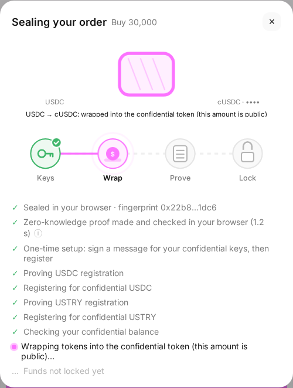 | **Sealing your order**: each step animated (keys, wrap, prove, lock) with its status; the first order also registers you for the confidential tokens with one wallet signature. |
| 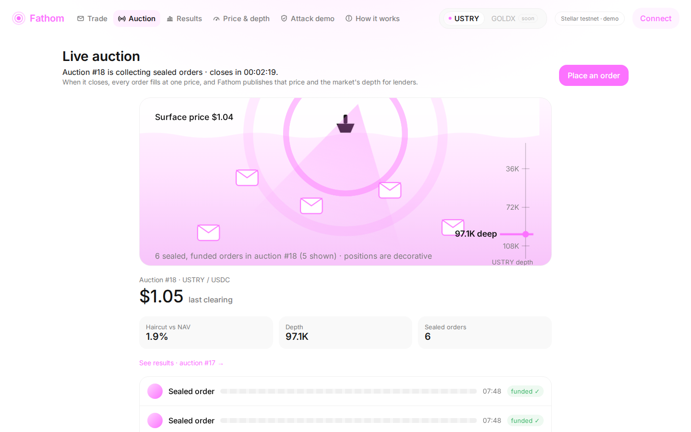 | **Auction**: the live auction taking orders, its countdown, the sealed orders (no prices shown), the last clearing price and the market depth. |
| 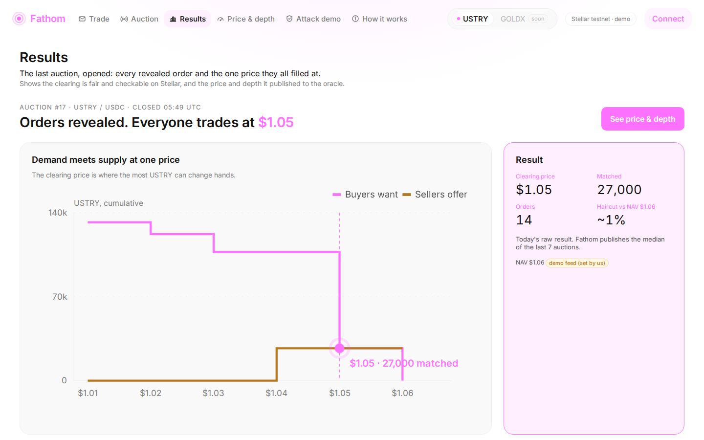 | **Results**: the last auction opened: supply meets demand at one price, every revealed order, and what was published to the oracle. |
| 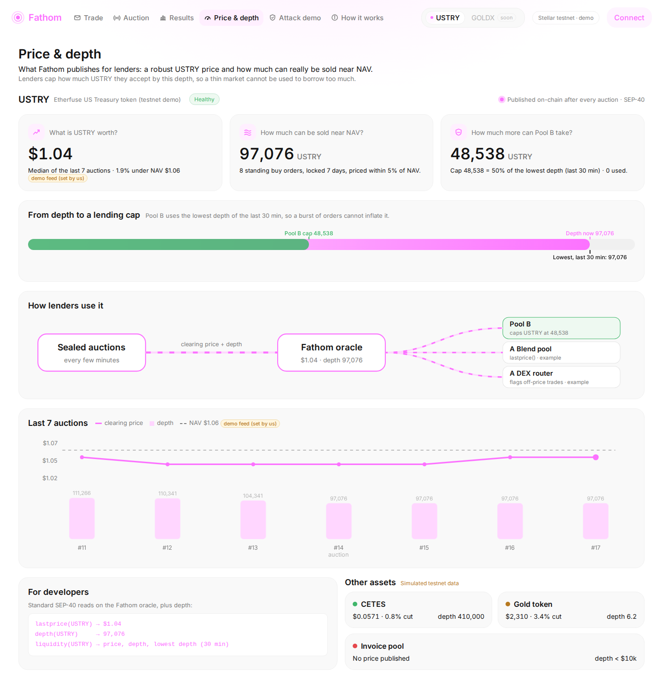 | **Price & depth**: what Fathom publishes for lenders: price, depth, how much more Pool B can take, the history, and the SEP-40 calls. |
| 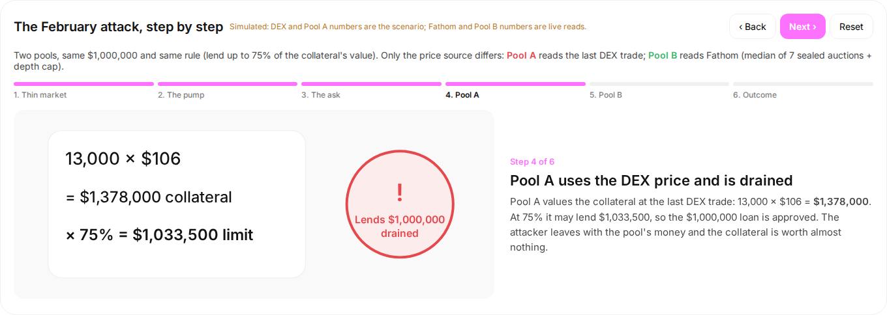 | **Attack demo**: the February attack in six steps, Pool A (DEX price) drained vs Pool B (Fathom) rejecting the same loan. With the presenter token it runs as real testnet transactions. |
| 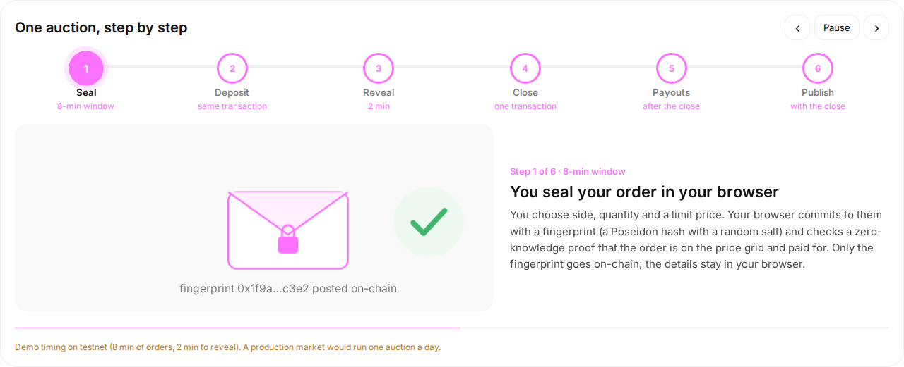 | **How it works**: a guided walkthrough of the six steps, what is hidden when, and what you are trusting in this demo. |

## Architecture

**Who talks to whom.** Your browser signs with your wallet and talks to Stellar directly; the demo
server only runs the bots, the auction loop, the faucet and the confidential payouts.

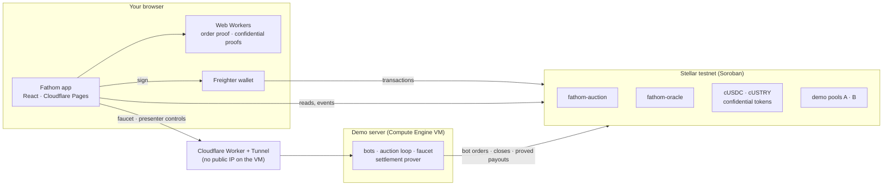

**What each contract does, and who calls it.**

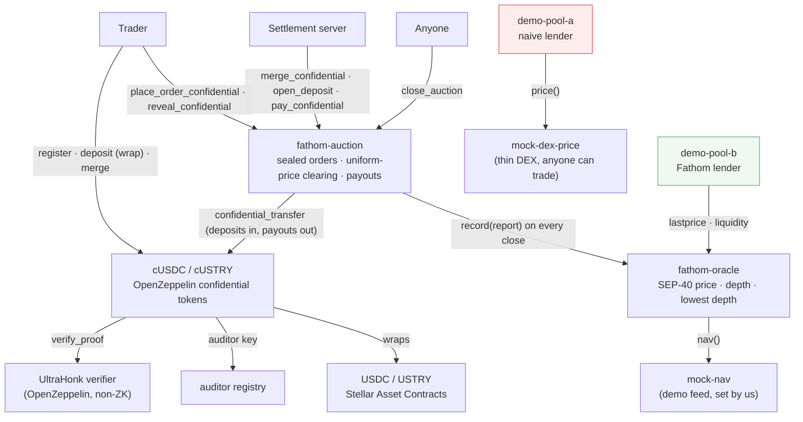

- **Push, not pull.** Each close pushes one report to the oracle in the same transaction; oracle reads
  never call another contract, so lenders get cheap, predictable reads.
- **Keys never in the browser.** The bots', admin's, attacker's and the auction's confidential keys live on
  the demo server (Google Secret Manager on the VM). The browser only signs with your wallet.
- **The auction cannot prove its own payouts** (a contract cannot keep a secret key), so the settlement
  server proves them; the contract checks every amount and recipient. See [honest limits](#honest-limits).
- **Hosting at $0/month:** a free-tier Compute Engine VM with no public IPv4, reachable only through a
  Cloudflare Tunnel and a Worker on `workers.dev`; the app on Cloudflare Pages; all in Terraform
  ([infra/README.md](infra/README.md)).

## Repository structure

```text
fathom/
├── contracts/                    Soroban contracts (Rust, soroban-sdk 28)
│   ├── fathom-auction/           sealed orders, reveal, clearing, payouts
│   │   └── src/
│   │       ├── lib.rs            orders, reveal, close, settle, admin, views
│   │       ├── confidential.rs   confidential deposits: commitment checks, proved payouts
│   │       ├── clearing.rs       uniform-price clearing on the tick grid
│   │       └── commitment.rs     Poseidon2 commitment (matches the Noir circuit)
│   ├── fathom-oracle/            SEP-40 price + depth per asset, fed by auction pushes
│   ├── demo-pool-a/              naive lender (last DEX price)
│   ├── demo-pool-b/              Fathom lender (Fathom price + depth cap, recorded rejections)
│   ├── mock-nav/                 demo NAV feed (set by us)
│   └── mock-dex-price/           demo thin-DEX last price (anyone can move it)
├── crates/fathom-common/         types and clients shared by the contracts
├── circuits/order/               Noir circuit: the order is on the grid and funded (nargo beta.9)
├── vendor/openzeppelin-confidential/   OpenZeppelin confidential token, verifier, auditor (wasm + provenance)
├── app/                          frontend (React 19, Vite, TypeScript)
│   ├── src/screens/              Trade, AuctionLive, Close (Results), Liquidity (Price & depth), Replay (Attack demo), HowItWorks
│   ├── src/components/           header, sealing modal, step animations, Trade background, …
│   ├── src/stellar/              wallet, contract client, commitments, confidential tokens, your orders
│   ├── src/zk/                   proving in Web Workers (order proof, confidential proofs)
│   ├── src/demo/                 presenter controls (shown only with the demo token)
│   └── tools/                    browser end-to-end test, screenshots, benchmarks
├── scripts/                      TypeScript: deploy, demo server, CLI demos
│   ├── config.ts                 every parameter in one place
│   ├── deploy.ts                 idempotent testnet deployment
│   ├── demo-server.ts            HTTP API: faucet, presenter actions, auction loop
│   └── lib/                      demo.ts (bots, loop, settlement) · confidential.ts · stellar.ts · fathom.ts
├── deployments/                  public contract ids per stack (testnet-confidential.json, testnet.json)
├── infra/                        Terraform: GCE VM, Cloudflare Pages/Tunnel/Worker, Workload Identity
├── docker/                       the demo server's container image (used by the VM)
├── designs/                      the original screen designs
└── docs/                         testnet run logs, number audit, design diff, screenshots, logo
```

## Run it locally

**1. Prerequisites:** Node 24. To trade, the [Freighter](https://freighter.app) wallet set to **Testnet**.

**2. Run the app** against the live testnet contracts and the hosted demo server (no keys, no setup):

```bash
cd app
npm install
npm run dev            # http://localhost:5173
```

In the app, connect Freighter, then use the funding panel under the order form: **Fund with Friendbot**,
**Add trustlines**, **Get demo tokens**. Then place an order; auctions close every ~10 minutes.

**3. Optional: your own stack on testnet** (your own contracts, bots and demo server). Also needs
Rust 1.92 and stellar-cli 28.1.

```bash
cargo test                                   # 41 contract tests
cd scripts && npm install
export FATHOM_DEPLOYMENT=my-testnet          # your own deployments/my-testnet.json
npm run deploy                               # creates your keys (Stellar CLI keystore), tokens and contracts
set -a; . ../.env.local; set +a              # the auction's confidential key, created by deploy
npm run demo-server -- --loop                # bots, auction loop, payouts on http://127.0.0.1:8787
# in another terminal:
cd app && DEMO_PROXY_TARGET=http://127.0.0.1:8787 npm run dev
```

`deploy` also writes your contract ids into `app/.env.confidential`. Add `CONFIDENTIAL_DEPOSITS=false`
(scripts) and use `npm run dev:fixed` (app) for the fixed-size-deposit variant.

**4. Tests**

```bash
cargo test                       # contracts (41)
cd app && npm test               # app unit tests (11): commitment parity, tx retry
DEMO_TOKEN=<token> node tools/e2e.mjs   # full browser-driven run on testnet (presenter token); logs every tx link
../circuits/build.sh             # Noir circuit: test, prove the example, write the verification key
```

**Deploying the hosted demo** (VM, tunnel, Worker, Pages) is described in [infra/README.md](infra/README.md).
The presenter controls (seed bots, next auction, run the attack live) appear only with
`?demo=<token>` (with it, also the demo burner wallet and the verifier panel); a bare `?demo` does
nothing, and visitors never see them.

## Reference

### Contract IDs (testnet)

The live stack, from `deployments/testnet-confidential.json`. The fixed-size stack is in
`deployments/testnet.json`.

<!-- contract-ids:start -->
| Contract | ID | Role |
|---|---|---|
| fathom-auction | [`CD66PTNIW7PY32N4OUKRFQJXHVDW5FBD2UZQG6AFHUTQVOU24QXE5GEM`](https://stellar.expert/explorer/testnet/contract/CD66PTNIW7PY32N4OUKRFQJXHVDW5FBD2UZQG6AFHUTQVOU24QXE5GEM) | sealed orders, reveal, clearing, settlement |
| fathom-oracle | [`CCHVIQYCZZXVHSEXRLHV53GIGACOLENCFNHJNBICS4JYJMZBDEYKS5PS`](https://stellar.expert/explorer/testnet/contract/CCHVIQYCZZXVHSEXRLHV53GIGACOLENCFNHJNBICS4JYJMZBDEYKS5PS) | SEP-40 price + depth |
| demo-pool-a | [`CB2XYQYVE5ZQEJSKFXNB47HKHNKW5WP2PCPMYRGVSZ2PKMBW5HCGGQ5P`](https://stellar.expert/explorer/testnet/contract/CB2XYQYVE5ZQEJSKFXNB47HKHNKW5WP2PCPMYRGVSZ2PKMBW5HCGGQ5P) | naive lender (DEX price) |
| demo-pool-b | [`CCUGEO27VXVN3EEISUZ2HNGOA4BNAM427ABIEMAPIWBJXGA3KDY7PG4B`](https://stellar.expert/explorer/testnet/contract/CCUGEO27VXVN3EEISUZ2HNGOA4BNAM427ABIEMAPIWBJXGA3KDY7PG4B) | Fathom lender (price + depth cap) |
| mock-nav | [`CDLLSBQXPVPRT4DM3MVOLAPQRJ72T44YWM2HSHVSEWKCDJGD37NU2E5T`](https://stellar.expert/explorer/testnet/contract/CDLLSBQXPVPRT4DM3MVOLAPQRJ72T44YWM2HSHVSEWKCDJGD37NU2E5T) | USTRY NAV, demo feed set by us |
| mock-dex-price | [`CDJNBL45S4OZABEBIH7ERSMXCSNE5QDIBGE35KIEIKOCHUBOVGQOFPQG`](https://stellar.expert/explorer/testnet/contract/CDJNBL45S4OZABEBIH7ERSMXCSNE5QDIBGE35KIEIKOCHUBOVGQOFPQG) | thin DEX last price, demo feed |
| USTRY (SAC) | [`CBMXMNLBQVECQ2G7USMEUIB6QLBEXEJF5M4BK4LGG53PYPJCTY5FPJWV`](https://stellar.expert/explorer/testnet/contract/CBMXMNLBQVECQ2G7USMEUIB6QLBEXEJF5M4BK4LGG53PYPJCTY5FPJWV) | demo token |
| USDC (SAC) | [`CBDCVIPPYUN5JZ5FHLXADKE34OHXXHPPBWUROJ53BGGAZLTQ5KCESXE2`](https://stellar.expert/explorer/testnet/contract/CBDCVIPPYUN5JZ5FHLXADKE34OHXXHPPBWUROJ53BGGAZLTQ5KCESXE2) | demo token |
| order verifier | [`CCFQPYDC7JKJPEIR6PQLT2VF4U2GRYGIK5QCNEUTRUVBGU6L63GRKFTA`](https://stellar.expert/explorer/testnet/contract/CCFQPYDC7JKJPEIR6PQLT2VF4U2GRYGIK5QCNEUTRUVBGU6L63GRKFTA) | rs-soroban-ultrahonk with circuits/order's vk (verifier demo) |
| issuer | [`GDSK6TCBLJJBAK4KG5BHKTSOZTMIONTJAOCTSHZM6U55M7J4S3OQB3SF`](https://stellar.expert/explorer/testnet/account/GDSK6TCBLJJBAK4KG5BHKTSOZTMIONTJAOCTSHZM6U55M7J4S3OQB3SF) | issues the demo tokens |
| cUSDC (confidential) | [`CCRMWYI4NHQMPYGVTL5MSBS5SJUZYPYEX52KJ4RXLT6S7LNY5Y7R24F6`](https://stellar.expert/explorer/testnet/contract/CCRMWYI4NHQMPYGVTL5MSBS5SJUZYPYEX52KJ4RXLT6S7LNY5Y7R24F6) | OpenZeppelin confidential token wrapping USDC |
| cUSTRY (confidential) | [`CDASZDGFIAKR3Q443BLI67IMG7OZKQYFABZBEO5ZO3BC4RQ5OYHD4ZTE`](https://stellar.expert/explorer/testnet/contract/CDASZDGFIAKR3Q443BLI67IMG7OZKQYFABZBEO5ZO3BC4RQ5OYHD4ZTE) | OpenZeppelin confidential token wrapping USTRY |
| confidential verifier | [`CBP2U65323GODHUBALNCZSQZZJBYEM6EB37GQGY5JPVKWEAOADQLJOYN`](https://stellar.expert/explorer/testnet/contract/CBP2U65323GODHUBALNCZSQZZJBYEM6EB37GQGY5JPVKWEAOADQLJOYN) | OpenZeppelin UltraHonk verifier (non-ZK), 6 circuit VKs |
| confidential auditor | [`CDALVDWVEQI56NRDAFO2GU5YD77KFNNWNFEMLWSAZYVPWBBNIMLZU7AM`](https://stellar.expert/explorer/testnet/contract/CDALVDWVEQI56NRDAFO2GU5YD77KFNNWNFEMLWSAZYVPWBBNIMLZU7AM) | OpenZeppelin auditor key registry |
<!-- contract-ids:end -->

### Contracts

All amounts and prices are 7-decimal fixed point (`$1.06 = 10_600_000`).

#### `fathom-auction`: sealed orders, clearing, payouts

| Method | Who | What it does |
|---|---|---|
| `place_order_confidential(owner, commitment, side, standing, data)` | trader | Seals an order: stores the commitment and takes a confidential deposit (`data` = an OpenZeppelin `TransferData`, owner → auction). Any amount; the side is public. |
| `reveal_confidential(owner, order_id, side, price_tick, qty, salt, amount, blinding)` | trader | In the reveal window: checks the order against its commitment and `amount·G + blinding·H == c_transfer`, then that the deposit covers the order. |
| `close_auction()` | anyone | After the reveal window: one uniform price that maximizes matched volume; records fills, refunds and the 1% penalty; carries standing buys; pushes the report to the oracle. |
| `merge_confidential()` | anyone | Folds the auction's received confidential deposits into its spendable balance. |
| `open_deposit(order_id, amount, blinding)` | anyone with the opening | After the close: releases an unrevealed confidential deposit minus the penalty. |
| `pay_confidential(order_id, base, amount, blinding, data)` | settlement server | Pays one recorded amount with a proved confidential transfer; the opening must equal the recorded amount, and it always goes to the order's owner. |
| `place_order(owner, commitment, deposit_token, deposit_amount, standing)` · `reveal(…)` · `settle(order_ids)` | trader · anyone | The fixed-size-deposit variant (`CONFIDENTIAL_DEPOSITS=false`): deposits of 10k / 50k / 250k, public payouts in batches. |
| `register_confidential(ctoken, auditor_id, data)` · `set_confidential(base, quote)` | admin | Registers the auction as a confidential account (proof made off-chain with its key) and turns the confidential path on. |
| `set_oracle(oracle)` · `set_params(params)` · `withdraw_fees()` · `fast_forward()` | admin | Wiring, parameters, collected penalties; `fast_forward` ends the current window now (demo only). |
| `current_auction()` · `closing_auction()` · `auction(id)` · `order(id)` · `orders_in(auction)` · `orders_of(owner)` · `standing_book()` · `fills(auction)` · `result(auction)` · `last_result()` · `conf_deposit(order_id)` · `commitment_of(…)` · `price_of(tick)` | anyone | Views used by the app. |

`commitment = Poseidon2(side, price_tick, qty, salt, owner_field)` over BN254, matching Noir's
`Poseidon2::hash` (a test pins a vector from nargo 1.0.0-beta.9); `owner_field = sha256(strkey)` with the
first byte zeroed. Close and settle are separate because testnet caps events at 16 KB per transaction.
Errors: [`types.rs`](contracts/fathom-auction/src/types.rs).

#### `fathom-oracle`: price and depth per asset (SEP-40)

| Method | Who | What it does |
|---|---|---|
| `register_asset(asset, auction, nav_feed)` | admin | Lets exactly one auction report for an asset, with its NAV feed. More assets need no redeploy. |
| `record(asset, report)` | that auction | Stores one auction's result and recomputes everything; reads never call out. |
| `lastprice(asset)` | lenders | Median of the last 7 clearing prices, capped at NAV. `None` if the last auction had < $10k notional or < 5 orders. |
| `price(asset, timestamp)` · `prices(asset, n)` · `last_timestamp()` · `base()` · `assets()` · `decimals()` · `resolution()` | lenders | The rest of SEP-40 (what Blend's oracle-aggregator needs). |
| `depth(asset)` | lenders | Open standing buy orders priced at most 5% below NAV. |
| `liquidity(asset)` | lenders | Price, NAV, haircut, depth, **lowest depth over the window**, orders, notional, status. |
| `state(asset)` · `asset_config(asset)` · `params()` · `set_params(…)` | anyone · admin | Internals and parameters. |

#### `demo-pool-a` and `demo-pool-b`: two lenders, one difference

Both lend USDC against USTRY up to 75% of the collateral's value. **Pool A** values USTRY at the thin DEX's
last trade (`mock-dex-price`). **Pool B** values it at Fathom's `lastprice` and refuses any borrow that would
take its total USTRY collateral above **50% of the lowest depth** over the oracle's window.

| Method | Pool | What it does |
|---|---|---|
| `borrow(user, collateral_qty, borrow_amount)` | A, B | Takes collateral, lends if the checks pass; fails with the first reason otherwise. |
| `assess(user, collateral_qty, borrow_amount)` | B | Every check with its numbers: collateral value at the Fathom price, max loan, depth cap vs requested. |
| `attempt_borrow(…)` | B | Same as `borrow`, but a rejection is **recorded on-chain** (`borrow_rejected` event, no funds moved), so the attack demo has a transaction to show. |
| `cap_status()` | B | The current depth cap and how much of it is used. |
| `position(user)` · `tvl()` · `config()` | A, B | Views (`total_collateral()` on A). |

Error codes (both pools): 1 no price, 2 depth too low, 3 not enough collateral, 4 pool empty, 5 bad amount.

#### `mock-nav` and `mock-dex-price`: demo feeds we set

| Contract | Methods | Role |
|---|---|---|
| `mock-nav` | `nav()` · `set_nav(nav)` (admin) · `last_update()` · `decimals()` | The USTRY NAV ($1.06), which caps Fathom's price and anchors depth. |
| `mock-dex-price` | `price()` · `trade(trader, price)` (anyone) · `last_update()` | A thin DEX's "last trade". One `trade` call is the attack's pump. |

#### External contracts

| Contract | Used methods | Role |
|---|---|---|
| OpenZeppelin confidential token (cUSDC, cUSTRY) | `register` · `deposit` · `merge` · `confidential_transfer` · `confidential_balance` | Balances as Pedersen commitments; each spend is proved (UltraHonk, non-ZK). [vendor/openzeppelin-confidential](vendor/openzeppelin-confidential/README.md) |
| OpenZeppelin verifier and auditor | `verify_proof` · `register_verification_key` · `register_key` · `get_key` | Proof checks for the confidential tokens; auditor key registry. |
| Order verifier (rs-soroban-ultrahonk) | `verify_proof` | Only for the "Verifier demo" panel on How it works, with a dummy order. |
| USDC / USTRY Stellar Asset Contracts | `transfer` · `balance` | The demo tokens from our test issuer. |

### Confidential deposits

`CONFIDENTIAL_DEPOSITS` (scripts, demo server, Terraform `confidential_deposits`) and
`VITE_CONFIDENTIAL_DEPOSITS` (app, `vite --mode confidential`) are on by default. `false` runs the
fixed-size escrow stack (`deployments/testnet.json`); `git checkout demo-stable` restores the build from
before this feature.

- **Tokens:** OpenZeppelin `stellar-confidential` 0.8.0 tokens wrapping the demo USDC and USTRY, with
  OpenZeppelin's UltraHonk verifier and an auditor contract. Own deployment:
  `deployments/testnet-confidential.json` (its own auction, oracle and pools).
- **In the browser:** one SEP-53 message signature per token (Freighter `signMessage`) derives the
  confidential keys (kept in memory); one-time `register` on both tokens; wrap and merge when short; then a
  confidential transfer to the auction, proved in a Web Worker (~1.5–2.5 s on a laptop), inside
  `place_order_confidential`.
- **Settlement server:** holds the auction's spending key (`FATHOM_CONF_AUCTION_SK`: Secret Manager on the
  VM, `.env.local` locally). After each close it merges the auction's received deposits and pays each
  recorded amount with one proved transfer, one at a time; unpaid auctions are kept in its state and
  resumed after a restart.
- **Timing:** auctions run 8 minutes (+2 to reveal), because each payout needs a proof. Measured: ~1.5 s
  per proof on a laptop. On the e2-micro, 3.5 s per proof in the hosted loop (auction #6: 8 payouts proved
  and paid in ~90 s); a back-to-back benchmark hit CPU throttling at ~22 s per proof, which 8 minutes still
  absorbs.

Testnet run with the flag on (browser, burner wallet): confidential seal
[7229e7c6…](https://stellar.expert/explorer/testnet/tx/7229e7c61cde53f5ebb4dda9e455355d50d74ab0ff2310f8bed7d051fb412866),
auto-reveal with the opening checked on-chain
[1e33ddbd…](https://stellar.expert/explorer/testnet/tx/1e33ddbd2921a6df4a24f393faa7e3008824dada7015c0e92f8eaa2d795eebd8),
close [0f66f863…](https://stellar.expert/explorer/testnet/tx/0f66f863db6ad001102688550d496705b99080d2806b72d718c4032523b32b30),
a proved payout [3a4f03b3…](https://stellar.expert/explorer/testnet/tx/3a4f03b3ee086ac64aedef454c633fccfe156272f23b5c919f242965533768f9),
attack replay [21b0b87d…](https://stellar.expert/explorer/testnet/tx/21b0b87d60e24dcda27767a6bf0e4e4d8c8e10810b090109241c5c1c74120444).
More in [docs/testnet-run.md](docs/testnet-run.md).

### Honest limits

What this demo does **not** protect, or does not do yet.

**Privacy**

- **Visible from the start:** each order's **side** (cUSDC deposit = buy, cUSTRY = sell), the owner's
  address and when the order was placed.
- **Price, quantity and deposit amount become public at the reveal**, which happens after the order window
  for that auction has closed (so nobody can still place an order against them), but before the close.
- **Wrapping is public and the app wraps exactly what is missing.** The first time an order needs
  confidential tokens, the app wraps exactly the shortfall, so that wrap transaction shows the deposit
  amount. Later orders paid from an existing confidential balance do not.
- **The demo settlement server can see deposit amounts.** The auction cannot make proofs itself (that needs
  its spending key, and a contract cannot keep a secret), so the server holds the auction's key: it can
  decrypt every deposit sent to the auction as it arrives.
- **Confidential-token proofs are not zero-knowledge yet.** They are UltraHonk proofs in the non-ZK flavour,
  verified on-chain by OpenZeppelin's verifier (on rs-soroban-ultrahonk); OpenZeppelin: "a proof is a
  deterministic function of the witness and carries no such guarantee". Amounts sit in Pedersen
  commitments; full amount privacy needs Soroban's zero-knowledge verifier.
- **The order's own zero-knowledge proof is checked in the browser, not on-chain.** Each order gets a
  zero-knowledge UltraHonk proof (`circuits/order`, Noir 1.0.0-beta.9, ~1.2 s in a Web Worker) that it is
  on the price grid and funded; it is verified in the browser and never posted, because the only Soroban
  verifier accepts non-ZK proofs, which can leak the order. The contract re-checks funding at reveal.
  On-chain verification runs only in the **Verifier demo** panel (How it works, with `?verifier`) for a fixed
  dummy order: [f13a8853…](https://stellar.expert/explorer/testnet/tx/f13a88532ec27f35820c29ff52c92bb84d720bb4e7e4387d27250c569701d87a).
  Its "tampered proof" check is a simulation, because a rejected verification is not recorded on-chain.
- **Auditor.** OpenZeppelin's confidential token encrypts every amount to an auditor key as well. Here that key
  was generated and its secret discarded, so nobody can use it; a production deployment would have a real
  auditor who can read amounts.

**Funds and trust**

- **Payouts go only to order owners, for the recorded amount.** The contract checks each payout's opening
  against what the close recorded and sends it to the order's owner; the token takes the recipient's key
  from chain state, so the server cannot redirect or misencrypt a payout. It can delay payouts: if it stops,
  they wait and resume when it restarts.
- **An unrevealed confidential deposit is not refunded automatically.** Its refund (minus the 1% penalty)
  needs the deposit's opening. The server has it only for the bots' orders; for your order it is saved in
  your browser, but the app has no button to submit it yet (`open_deposit`). Keep the tab open in the
  reveal window, which reveals automatically.
- **No unwrap in the app.** Payouts arrive as cUSDC / cUSTRY; turning them back into public USDC / USTRY
  (the token's `withdraw`, with a proof) is not in the app yet.
- **Admin powers.** The auction runs with `demo: true`, so its admin can end the order or reveal window early
  (`fast_forward`, the presenter's "Next auction") and change parameters.
- **Testnet demo, not audited.** Demo tokens from our own issuer; the USTRY NAV ($1.06) and the DEX price are
  feeds we set (`mock-nav`, `mock-dex-price`), tagged in the app.

**Integration**

- **Blend reads prices through the oracle-aggregator.** [blend-capital/oracle-aggregator](https://github.com/blend-capital/oracle-aggregator)
  calls `price(asset, timestamp)`, `last_timestamp`, `resolution` and `decimals` on its source (Fathom has
  all four). It passes on **price only, not depth** (the depth cap is Pool B's own logic), and it ignores
  prices older than its `max_age` (360–3600 s), so daily auctions would need the price republished at least
  hourly. Nothing here is integrated with a real Blend pool.
- **Bait-and-switch window is short in the demo:** Pool B uses the lowest depth over 30 minutes
  (production: weeks), so depth added just before a demo does not count yet.
- **Sybil / wash resistance** relies on locked, non-cancellable standing bids; bonded membership and
  nullifiers are not implemented.

### Concurrency notes

- Order ids are derived from the commitment, not a counter, so concurrent orders touch different keys.
- `place_order` appends to the auction's order list; clients declare 512 extra write bytes so an order
  that lands just after another one does not fail ("byte-write resources exceeds amount specified").
- Transactions that fail on-chain (nothing applied) are re-simulated and resent after a short random wait.

### Toolchain (pinned)

| Tool | Version | Why this version |
|---|---|---|
| Rust | 1.92.0, target `wasm32v1-none` | `rust-toolchain.toml` |
| soroban-sdk | 28.0.0 | required by rs-soroban-ultrahonk and soroban-poseidon |
| stellar-cli | 28.1.0 | |
| Noir (nargo) | 1.0.0-beta.9 | our order circuit; the version the UltraHonk verifier supports |
| Barretenberg (bb) | 0.87.0 | same; Keccak oracle |
| OpenZeppelin confidential circuits | nargo 1.0.0-beta.11, bb 0.87.0 | via stellar-confidential-token-sdk `aad1706`, in their own Web Worker |
| OpenZeppelin confidential contracts | stellar-confidential 0.8.0 | vendored wasm, [vendor/openzeppelin-confidential](vendor/openzeppelin-confidential/README.md) |
| Node | 24 | |

Testnet runs protocol 29 (the verifier needs ≥ 28). Installing bb 0.87.0: `bbup -v 0.87.0` builds a wrong
release URL; download it directly:
`curl -L https://github.com/AztecProtocol/aztec-packages/releases/download/v0.87.0/barretenberg-amd64-linux.tar.gz | tar -xzC ~/.bb`

### Glossary

| Term | Meaning |
|---|---|
| **RWA token** | A token for a real-world asset, here a tokenized US Treasury fund (USTRY). |
| **NAV** | Net asset value: what one token is worth according to its issuer. A demo feed here. |
| **Sealed order** | An order whose price and quantity are hidden behind a commitment until it is revealed. |
| **Commitment / fingerprint** | A hash (Poseidon2) of the order with a random salt; it binds you to the order without showing it. |
| **Uniform price** | Every filled order trades at the same clearing price, whatever its limit. |
| **Standing order** | A buy order locked for 7 days that stays in the book across auctions. Only these count as depth. |
| **Depth** | How much USTRY could be sold near NAV: standing buy orders within 5% of NAV. |
| **SEP-40** | Stellar's standard oracle interface (`lastprice`, `price`, …), used by lending protocols such as Blend. |
| **Confidential token** | An OpenZeppelin token whose balances and transfer amounts are Pedersen commitments. |
| **Pedersen commitment** | `amount·G + blinding·H` on the Grumpkin curve: hides an amount, opened by disclosing amount and blinding. |
| **Wrap** | Moving public tokens into the confidential token (the wrapped amount is public). |
| **UltraHonk, ZK / non-ZK** | The proof system used. Only the non-zero-knowledge flavour can be verified on Soroban today. |
| **SAC** | Stellar Asset Contract: the Soroban contract for a classic Stellar asset. |
| **Testnet** | Stellar's public test network; nothing here has real value. |
