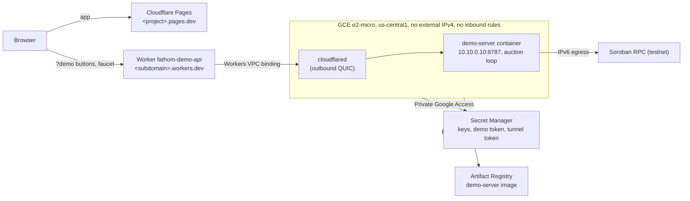

# Fathom infra: Google Compute Engine free tier + Cloudflare (no domain)

The demo server runs on one free-tier **e2-micro** VM. The app is on **Cloudflare Pages**
(`https://<project>.pages.dev`). The demo API is a small **Worker** on
`https://fathom-demo-api.<subdomain>.workers.dev` that reaches the VM through **Cloudflare Tunnel** with
**Workers VPC**: no domain, no DNS record, no public hostname, no inbound access to the VM.
Everything is Terraform, with no key files.



## Cost

| Item | Monthly |
|---|---|
| e2-micro in us-central1, 30 GB standard disk | $0 (free tier: 1 instance, 30 GB-month) |
| External IPv4 | **not used** (it would be billed: $0.005/h ≈ $3.65) |
| Cloud NAT | **not used** (≈ $0.0014/VM-h + its own IPv4 $0.005/h + $0.045/GiB ≈ $4.70) |
| External IPv6 (outbound traffic) | $0 (IPv6 addresses on VMs are not billed) |
| Egress | $0 within the 1 GB/month free tier: the server mostly *receives* (ingress is free) |
| Secret Manager: 3 secrets, 1 version each | $0 (6 active versions free) |
| Artifact Registry: last 3 images | $0 (0.5 GB free) |
| Cloudflare Pages, Tunnel, Worker (100k requests/day free), Workers VPC (free during its beta) | $0 |
| **Total** | **$0**, with a $5 budget alert |

Why no IPv4 and no NAT: everything the server talks to has IPv6 (Soroban RPC, Friendbot, the Cloudflare
tunnel edge, the Ubuntu and Cloudflare apt repos), and Google APIs go through Private Google Access. The
demo server uses Soroban RPC only (not Horizon, which is IPv4-only on testnet). If IPv6 egress ever fails,
set `external_ipv4 = true` (adds ≈ $3.65/month); Cloud NAT would cost more than that.

Sources: [VPC pricing: external IPs](https://cloud.google.com/vpc/pricing-announce-external-ips),
[Cloud NAT pricing](https://cloud.google.com/nat/pricing), [free tier](https://cloud.google.com/free/docs/free-cloud-features#compute).

## Security

- **No inbound internet access.** The only firewall rule allows SSH from Identity-Aware Proxy
  (35.235.240.0/20). The API is reached through the tunnel, which makes outbound connections only;
  the Worker reaches the server only through its Workers VPC binding. The Worker forwards `/demo/*` and
  `/healthz` and nothing else.
- **The VM's service account** can only pull from the `fathom` repository and read its three secrets.
- **Secrets.** Terraform creates the Secret Manager containers, never the values of the Stellar keys or
  the demo token: you add those by hand, so they never reach Terraform state. The tunnel token is the
  exception: Terraform creates the tunnel, so it already holds it, and writes it to Secret Manager.
- **On the VM** secrets are read at every boot into `/run/fathom` (tmpfs). The demo server listens on
  127.0.0.1, demo actions need the bearer token, every POST is rate limited per IP and the faucet per
  address, and CORS allows only the Pages URL.
- **Terraform Cloud** runs impersonate `fathom-terraform` through Workload Identity Federation, limited
  to your organization/project/workspace. Its secrets role cannot read secret values.

## What you do yourself

### 0. Once: accounts and tools

- Google Cloud project `celadari-hack-meridian-2026` (display name *celadari-hackathon-meridian-2026*;
  project IDs are limited to 30 characters) with billing enabled.
- A Cloudflare account. If you have never used Workers, open **Workers & Pages** once so the account
  gets its `workers.dev` subdomain (Settings → Subdomain); you need that name below.
- A Cloudflare API token (https://dash.cloudflare.com/profile/api-tokens → Create Token → Create Custom Token; it is under
  your *profile*, not the account settings; a new account must verify its email first), account-level permissions:
  **Cloudflare Pages · Edit**, **Cloudflare Tunnel · Edit**, **Workers Scripts · Edit**,
  **Connectivity Directory · Admin** (Workers VPC services). No zone permissions: there is no domain.
- An HCP Terraform organization.
- Locally: Terraform ≥ 1.10, `gcloud`, Docker, Node 24, `tflint` (for `scripts/check.sh`).

```bash
export PROJECT_ID=celadari-hack-meridian-2026
gcloud auth login
gcloud auth application-default login          # for bootstrap/, applied from your laptop; no key file
gcloud config set project "$PROJECT_ID"
```

### 1. Bootstrap (budget alert; WIF for Terraform Cloud)

```bash
cd infra/bootstrap
terraform init
terraform apply \
  -var project_id="$PROJECT_ID" \
  -var billing_account_id="$(gcloud billing projects describe "$PROJECT_ID" --format='value(billingAccountName)' | cut -d/ -f2)" \
  -var tfc_organization=Hackathon_Meridian_2026
```

### 2. Infra on Terraform Cloud

1. Create the workspace `fathom-infra` (CLI-driven) in your organization, project `Default Project`
   (or match `tfc_project` / `tfc_workspace` in bootstrap).
2. Workspace variables:
   - Environment: the three values from `terraform -chdir=infra/bootstrap output tfc_workspace_env`
     (`TFC_GCP_PROVIDER_AUTH=true`, `TFC_GCP_RUN_SERVICE_ACCOUNT_EMAIL`, `TFC_GCP_WORKLOAD_PROVIDER_NAME`),
     and `CLOUDFLARE_API_TOKEN`, marked **sensitive**.
   - Terraform: `project_id`, `cloudflare_account_id`, `workers_dev_subdomain`.
3. `cp cloud.tf.tfc cloud.tf` (organization `Hackathon_Meridian_2026`), then:

```bash
cd infra
terraform login
terraform init
terraform apply -target=google_artifact_registry_repository.fathom   # the repo first, for the image
```

HCP Terraform Free (2026): up to **500 managed resources** and **1 concurrent run**. This configuration
manages about 20 ([HashiCorp plans](https://developer.hashicorp.com/terraform/cloud-docs/overview)).

Running locally instead (state on your disk): skip `cloud.tf`, `cp example.tfvars terraform.tfvars`,
export `CLOUDFLARE_API_TOKEN`, and use the same commands with application-default credentials.

### 3. Image, secret values, everything else

```bash
infra/scripts/build-and-push.sh                                   # demo-server image → Artifact Registry

# Secret values: by hand, never through Terraform.
(cd scripts && npx tsx export-demo-secrets.ts) \
  | gcloud secrets versions add fathom-demo-keys --data-file=-    # the FATHOM_KEY_* lines
openssl rand -hex 24 | tr -d '\n' > /tmp/fathom-demo-token        # keep this: it unlocks the demo buttons
gcloud secrets versions add fathom-demo-token --data-file=/tmp/fathom-demo-token
cat /tmp/fathom-demo-token; rm /tmp/fathom-demo-token

terraform -chdir=infra apply                                      # VM, tunnel, VPC service, Worker, Pages, IAM
npx wrangler@4.152.0 login                                        # once, for the frontend deploy (OAuth, no token file)
infra/scripts/deploy-frontend.sh                                  # wrangler pages deploy, VITE_DEMO_API=<Worker URL>/demo
```

The VM boots, installs Docker and cloudflared, reads the secrets and starts the server: give it ~3
minutes. Then `curl "$(terraform -chdir=infra output -raw api_url)/healthz"` → `{"ok":true}`, and open
`$(terraform -chdir=infra output -raw app_url)/?demo=<token>`.

### Later

```bash
infra/scripts/build-and-push.sh && infra/scripts/redeploy-server.sh   # new server code
infra/scripts/deploy-frontend.sh                                       # new app build
$(terraform -chdir=infra output -raw ssh_command)                      # shell on the VM (IAP)
sudo journalctl -u fathom-demo -u fathom-tunnel -f                     # on the VM: logs
```

Rotating a secret: add a new version, then `infra/scripts/redeploy-server.sh`.

## Checks

```bash
infra/scripts/check.sh      # terraform fmt -check, validate, tflint (google ruleset), both modules
```
